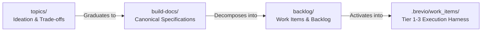
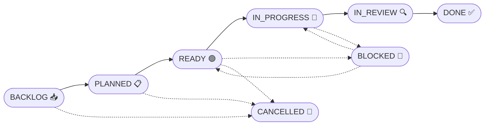

# Backlog & Work Item Management Framework

This is the `backlog/` workspace for **`brevio` (Token Optimized Software Harness)**.

This directory is the central place for the backlog and the development work items. It connects three areas: the
high-level architectural ideas in [`topics/`](../topics/README.md), the canonical specifications in
[`build-docs/`](../build-docs/README.md), and the detailed code implementation.

Each discrete feature, improvement, or bug fix has its own work item document. The file name follows the convention [`WORK-ITEM-###_{file-name-slug}.md`](#file-naming--organization-conventions). [`backlog.jsonl`](backlog.jsonl) indexes all work items, and the generated [`backlog.md`](backlog.md) shows them in one place.

---

## Table of Contents

1. [Role & Relationship in Brevio](#role--relationship-in-brevio)
2. [Work Item Lifecycle & State Machine](#work-item-lifecycle--state-machine)
3. [File Naming & Organization Conventions](#file-naming--organization-conventions)
4. [Using `backlog.md`](#using-backlogmd)
5. [Authoring `WORK-ITEM-###_{file-name-slug}.md`](#authoring-work-item-file-name-slugmd)
6. [Work Item Template Structure](#work-item-template-structure)
7. [Step-by-Step Workflow](#step-by-step-workflow)
8. [Relationship to Work Items Runtime](#relationship-to-work-items-runtime)

---

## Role & Relationship in Brevio

This table shows the place of `backlog/` in the `brevio` documentation. Each area has a separate concern:

| Dimension | `topics/` (Ideation & Deliberation) | `build-docs/` (Canonical Specs) | `backlog/` (Development Backlog) | `.brevio/work_items/` (Execution Harness) |
| :--- | :--- | :--- | :--- | :--- |
| **Purpose** | Brainstorms, evaluation of trade-offs, architectural agreement. | Authoritative blueprints, contracts, schemas, and the current-state design. | Work items that declare intents, and a prioritized backlog. | Runtime XHTML documents that a machine can parse, telemetry, and execution logs. |
| **Document Format** | Markdown (`TOPIC-###_slug.md`) | Markdown specs across component domains | Markdown (`WORK-ITEM-###_slug.md` & `backlog.md`) | Strict XHTML 1.0/5 documents and JSON ledgers |
| **State** | Divergent, exploratory. | Convergent, normative, prescriptive. | Tactical, progressive, sprint-oriented. | Operational, atomic, task-oriented. |
| **Primary Audience** | Architects, designers, and engineers during ideation. | Implementers, agentic LLMs, code generators. | Product owners, engineers, and agent harnesses that execute backlog tasks. | The running agent harness, the static visualizer, automated verification loops. |



---

## Work Item Lifecycle & State Machine

Each work item moves through a deterministic lifecycle, from its first entry in the backlog to completion:



### State Definitions

| Status | Description | Exit Criteria |
| :--- | :--- | :--- |
| **`BACKLOG`** | A new idea or task. A high-level summary exists, but the invariants and evidence are not final yet. | Groomed, scoped, and prioritized for a milestone. |
| **`PLANNED`** | Assigned to a future milestone or sprint. The team is refining the scope and dependencies. | Acceptance criteria written, technical approach agreed. |
| **`READY`** | Fully refined and groomed. Acceptance criteria defined, estimate assigned, dependencies unblocked. A developer or agent can start it. | The assignee starts the work. |
| **`IN_PROGRESS`** | Development and test writing are in progress. | All tasks checked, unit tests pass locally, PR opened. |
| **`IN_REVIEW`** | Implementation complete. The PR is submitted for code review, automated CI verification, or agent audit. | PR approved and merged. |
| **`DONE`** | Verification criteria met, code merged to `main`, documentation updated. | Archived in `backlog.md`. |
| **`BLOCKED`** | The work cannot continue because of an external dependency, a technical problem, or an upstream issue. | Blocker resolved, and the work item goes back to its previous state. |
| **`CANCELLED`** | Not necessary, a duplicate, or replaced by other work. The work item file records the reason. | Terminal state. |

---

## File Naming & Organization Conventions

Work item files follow a strict naming pattern, so that human developers and automated tools parse them in the same way:

$$\mathbf{\text{backlog/WORK-ITEM-###\_\{file-name-slug\}.md}}$$

### Breakdown:

1. **Prefix**: `WORK-ITEM-` in uppercase.
2. **Identifier (`###`)**: A three-digit, zero-padded, sequential integer (`001`, `002`, `003`, ..., `042`, and so on).
3. **Delimiter**: An underscore (`_`) between the work item ID and the slug.
4. **Slug (`{file-name-slug}`)**: A short, lowercase, kebab-case description of the feature or task.
5. **Extension**: `.md` (Markdown).

### Valid Examples:

- `backlog/WORK-ITEM-001_initialize-cli-skeleton-and-root-command.md`
- `backlog/WORK-ITEM-002_xhtml-metadata-parser-and-xpath-evaluator.md`
- `backlog/WORK-ITEM-003_mcp-server-protocol-handshake-and-tools.md`
- `backlog/WORK-ITEM-004_static-ui-dashboard-scaffold.md`

> [!WARNING]
> Do not use a hyphen `-` as the separator between the ID and the slug (for example, do not use `WORK-ITEM-001-slug.md`). Use an underscore `_` (for example, `WORK-ITEM-001_slug.md`). The underscore keeps a clear separation between the work item identifier and the descriptive slug.

---

## Using `backlog.md`

[`backlog.md`](backlog.md) is the central index and dashboard for all work items in the project. It has the same role for work items that `topics/topic-registry.md` has for topics.

`backlog.md` is a generated file. Do not edit it by hand. The data is in [`backlog.jsonl`](backlog.jsonl), with one JSON object on each line. The script [`scripts/backlog.mjs`](scripts/backlog.mjs) changes the data. Each time, it also rebuilds `backlog.md` from [`backlog.template.md`](backlog.template.md).

### Backlog Script

Run the script with Node.js from the repository root:

```bash
node backlog/scripts/backlog.mjs next-id
node backlog/scripts/backlog.mjs add --title "Initialize CLI Skeleton" --domain CLI --priority P1
node backlog/scripts/backlog.mjs edit --id 1 --status PLANNED
node backlog/scripts/backlog.mjs remove --id 1
node backlog/scripts/backlog.mjs generate
node backlog/scripts/backlog.mjs list --status READY
node backlog/scripts/backlog.mjs check
```

| Command | Effect |
| :--- | :--- |
| `next-id` | Prints the next free `WORK-ITEM-###` identifier. |
| `add` | Appends a record, writes the dates, and rebuilds `backlog.md`. |
| `edit` | Changes fields of a record. On a status change, it sets `active` the first time the item leaves `BACKLOG`. It sets `completed` on `DONE` or `CANCELLED`. |
| `remove` | Deletes the record and the `WORK-ITEM-###_*.md` file. To keep the file, add `--keep-file`. |
| `generate` | Rebuilds `backlog.md` and does not change the data. |
| `list` | Prints records as JSON lines. To filter, use `--status` or `--id`. |
| `check` | Reports drift between `backlog.jsonl` and the work item files. It changes nothing. |

### Record Schema (`backlog.jsonl`):

| Field | Description |
| :--- | :--- |
| `id` | `WORK-ITEM-###` |
| `title`, `slug` | The human-readable title and the kebab-case file name slug |
| `status` | `BACKLOG`, `PLANNED`, `READY`, `IN_PROGRESS`, `IN_REVIEW`, `DONE`, `BLOCKED`, `CANCELLED` |
| `priority` | `P0`, `P1`, `P2`, `P3` |
| `domain`, `tier` | Subsystem and autonomy tier |
| `assignee`, `milestone` | Owner and target release |
| `created`, `active`, `updated`, `completed` | Dates as `YYYY-MM-DD`, or `—` for a date that is not set |

The work item files keep the intent details (invariants, evidence, scope). The record keeps only the index fields.

### Key Responsibilities:

- Single source of truth: `backlog.jsonl` holds the index. To find what to work on next, what is in progress, or what is delivered, read `backlog.md`.
- Status synchronization: When a work item changes status, the script updates `backlog.jsonl` and rebuilds `backlog.md` in the same run.
- Metrics ledger: Each time the script generates `backlog.md`, it counts the work items in each state.
- Layout changes: Edit `backlog.template.md` (markers `{{METRICS_ROW}}`, `{{ACTIVE_ROWS}}`, `{{ARCHIVE_ROWS}}`). Then run `generate`.

### Table Schema:

| Column | Description | Example |
| :--- | :--- | :--- |
| **ID** | Markdown link to the individual work item file | `[`WORK-ITEM-001`](WORK-ITEM-001_cli-init.md)` |
| **Title** | Human-readable work item title | Initialize CLI Skeleton & Root Command |
| **Status** | Current lifecycle state | `READY`, `IN_PROGRESS`, `DONE` |
| **Priority** | Urgency and impact rating (`P0`, `P1`, `P2`, `P3`) | `P1` |
| **Autonomy Tier** | Agent autonomy level (`observe`, `propose`, `change-with-review`, `scoped-automation`) | `propose` |
| **Domain** | Target subsystem (`CLI`, `MCP`, `Static UI`, `Work Items`, `Wiki`, `OpenAPI`, `Core`) | `CLI` |
| **Assignee** | GitHub handle or agent identifier | `@developer` |
| **Target Release** | Milestone or release version | `v0.1.0` |
| **Active** | The date on which the work item first left `BACKLOG` (`YYYY-MM-DD`, or `—` for a work item that is still in `BACKLOG`) | `2026-09-06` |
| **Last Updated** | Date of the last change to state or content (`YYYY-MM-DD`) | `2026-09-06` |

### Sorting Rule (Active & Planned Work Items):

The script sorts the rows in the Active & Planned Work Items table by Active Date, ascending. The work item that is active for the longest time is at the top. Rows with `—` (still in `BACKLOG`) go below all rows with a date, sorted by Created Date, ascending. If two rows are equal, `WORK-ITEM-###` ascending decides the order.

---

## Authoring `WORK-ITEM-###_{file-name-slug}.md`

> [!TIP]
> Tool support: To create and register work items, use the `/create-work-item` skill (or the `backlog-manager` agent). It allocates the ID, captures the intent in short rounds, writes the file from the template, and registers the record through `scripts/backlog.mjs`.

A work item declares an intent. It states what the system must achieve, which invariants must stay true, and which evidence proves the result. It does not prescribe steps. It holds no user story and no story points.

To create a work item manually:

1. Copy [`backlog/template.md`](template.md) to `backlog/WORK-ITEM-###_{file-name-slug}.md`.
2. Fill the metadata table. Set the ID, status, priority, domain, autonomy tier, author, and `Active Date` (`—` for `BACKLOG`, the activation date for `PLANNED` or later).
3. Declare the intent. Write the desired outcome, the affected users and systems, and the motivation.
4. Add context. Link the problem to [`topics/`](../topics/README.md) and [`build-docs/`](../build-docs/README.md).
5. Define the invariants. Write each invariant with a class, a shell command, and an enforcement level.
6. Set the boundary envelope. List the in-scope items, the out-of-scope items, and the constraints.
7. Define the evidence. Write each observable outcome with a verification command.
8. List the candidate sub-intents. Name the milestones and their dependencies.
9. Register the work item in the backlog. Run `node backlog/scripts/backlog.mjs add ...`. The script updates `backlog.jsonl` and rebuilds `backlog.md`.

---

## Work Item Template Structure

Each work item file contains these sections:

```markdown
# WORK-ITEM-###: [Work Item Title]

| Metadata | Value |
| :--- | :--- |
| **Work Item ID** | `WORK-ITEM-###` |
| **Status** | `BACKLOG` |
| **Priority** | `P2 - Medium` |
| **Domain / Component** | `CLI` |
| **Autonomy Tier** | `propose` |
| **Author** | @username |
| **Assignee** | Unassigned |
| **Target Milestone** | `v0.1.0` |
| **Related Topic(s)** | [`TOPIC-###`](../topics/TOPIC-###_slug.md) |
| **Target Build-Doc(s)** | [`build-docs/...`](../build-docs/README.md) |
| **Runtime Directory** | — |
| **Created Date** | YYYY-MM-DD |
| **Active Date** | — |
| **Last Updated** | YYYY-MM-DD |

## 1. Declared Intent
## 2. Context & Background
## 3. System Invariants
## 4. Boundary Envelope
## 5. Evidence Requirements
## 6. Technical Approach & Design References
## 7. Candidate Sub-Intents
## 8. Definition of Done (DoD)
## 9. Dependencies & Blockers
## 10. Open Questions
## 11. Activity Log & Notes
```

---

## Step-by-Step Workflow

Use this procedure to create, execute, and close a work item. The skills `/create-work-item`, `/update-work-item-status`, and `/update-backlog` automate these steps:

```
┌─────────────────────────────────────────────────────────────┐
│ 1. Work Item Creation (/create-work-item)                   │
│    - Allocate next ID: WORK-ITEM-###                        │
│    - Capture intent, invariants, evidence                   │
│    - Write WORK-ITEM-###_{slug}.md                          │
│    - Register record via scripts/backlog.mjs add            │
└──────────────────────────────┬──────────────────────────────┘
                               │
                               ▼
┌─────────────────────────────────────────────────────────────┐
│ 2. Grooming (/update-work-item-status)                      │
│    - Add commands to invariants and evidence                │
│    - Assign priority and autonomy tier                      │
│    - Set status to READY (needs both gates)                 │
│    - Use /update-backlog for bulk field edits               │
└──────────────────────────────┬──────────────────────────────┘
                               │
                               ▼
┌─────────────────────────────────────────────────────────────┐
│ 3. Execution (/update-work-item-status)                     │
│    - Assignee claims it (status IN_PROGRESS)                │
│    - Seed .brevio/work_items/ and set Runtime Directory       │
│    - Agent converges the sub-intents and units              │
└──────────────────────────────┬──────────────────────────────┘
                               │
                               ▼
┌─────────────────────────────────────────────────────────────┐
│ 4. Verification & Review (/update-work-item-status)         │
│    - Open PR (status IN_REVIEW)                             │
│    - Every invariant holds, every evidence item passes      │
│    - Satisfy the Definition of Done                         │
└──────────────────────────────┬──────────────────────────────┘
                               │
                               ▼
┌─────────────────────────────────────────────────────────────┐
│ 5. Merge & Archive (/update-work-item-status)               │
│    - Merge PR into main                                     │
│    - Set status to DONE                                     │
│    - Row moves to Completed & Archived                      │
│    - Metrics update (or run /update-backlog)                │
└─────────────────────────────────────────────────────────────┘
```

---

## Relationship to Work Items Runtime

A work item is the parent of all intent-driven SDLC documents. It has the role that a story has in a standard SDLC, where the standard documents are children of the story. At some point, an agentic LLM or a human engineer starts active execution of a work item. At that time, the work item file gives the initial content of a runtime intent package under `.brevio/work_items/{timestamp}_{slug}/`. The `Runtime Directory` metadata row records the path.

1. Declared Intent, Boundary Envelope, Invariants, and Evidence Requirements become `00_intent_spec.html`. The `Autonomy Tier` row becomes the `autonomy-tier` tag.
2. Technical Approach gives input to `01_solution_strategy.html`.
3. Candidate Sub-Intents become the sub-intents in `02_intent_decomposition.html`. The ledger `03_intent_ledger.json` controls their state.
4. Open Questions go into the open questions section of the intent specification.

The backlog status (`BACKLOG` to `DONE`) is separate from the `convergence-status` of the runtime package. The work item moves to `DONE` after the intent is `settled` and the pull request is merged.

This gives traceability from end to end: from ideas in `topics/`, through the canonical architecture in `build-docs/` and the planned work in `backlog/`, to live execution in `.brevio/work_items/`.
