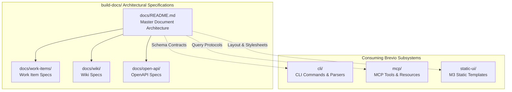
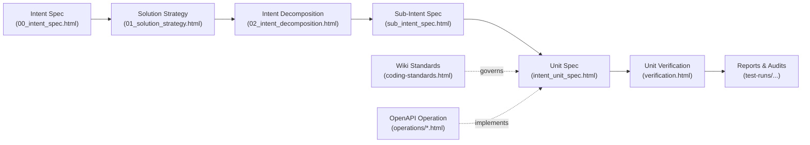

# Brevio Document System Specification

> The master architectural specification for the `brevio` document system. It defines the requirements, schemas, and metadata of every document type that `brevio` creates, manages, and reads. It also defines the domain taxonomy and the query models.

---

## Table of Contents

1. [Scope & Role within Build-Docs](#scope--role-within-build-docs)
2. [Core Principles & Token Economics](#core-principles--token-economics)
3. [Universal XHTML Document Standard](#universal-xhtml-document-standard)
4. [Document Domain Taxonomy](#document-domain-taxonomy)
   1. [Work Item Documents (`work-items/`)](#1-work-item-documents)
   2. [Project Wiki Documents (`wiki/`)](#2-project-wiki-documents)
   3. [OpenAPI Specifications (`open-api/`)](#3-openapi-specifications)
5. [Domain Specification Inventory & Blueprint](#domain-specification-inventory--blueprint)
6. [Target Project Runtime Layout (`.brevio/`)](#target-project-runtime-layout-brevio)
7. [Targeted Querying & XPath Extraction Patterns](#targeted-querying--xpath-extraction-patterns)
8. [Cross-Domain Graph Traversal & Traceability](#cross-domain-graph-traversal--traceability)
9. [Subsystem Integration Matrix](#subsystem-integration-matrix)
10. [Storage & Version Control Guidelines](#storage--version-control-guidelines)
11. [Rules & Constraints](#rules--constraints)
12. [Revisions](#revisions)

---

## Scope & Role within Build-Docs

During the ideation and design phase of the product, the [`build-docs/`](../README.md) directory holds the canonical specifications to build `brevio`. In this hierarchy, `build-docs/docs/` is the master specification of the data layer of `brevio`:

- Normative document contracts: Sets the required structure, XHTML schemas, semantic `<head>` metadata, and body sections for every artifact that `brevio` generates.
- Token-optimized schema design: Makes sure that each document has a structure for fast local extraction with XML parsers and XPath queries. This keeps LLM prompts small.
- Single-pane visual integration: Makes sure that every document complies with the Material Design 3 static UI specifications in [`build-docs/static-ui/`](../static-ui/README.md).
- Subsystem alignment: Gives the input for the command tree of the [`CLI`](../cli/README.md) and the tool catalog of the [`MCP Server`](../mcp/README.md).



---

## Core Principles & Token Economics

The Brevio document architecture follows four operational principles:

1. Local-first processing: All documents are in the local workspace under `.brevio/`. Reads, queries, and updates of documents occur locally, with no cloud latency and no remote API round trips.
2. Polyglot XHTML standard: Documents use strict XHTML 1.0/5 syntax. They are valid XML for programmatic engines (DOM, XPath, SAX). They also work natively in standard web browsers with CSS and web components.
3. Granular subtree ingestion: Agent tools query specific XML subtrees (for example, only `//section[@id='acceptance-criteria']` or `/html/head/meta[@name='status']`). The tools deliver only the necessary fragments. This saves tokens (typically an 80%–95% reduction compared to a full document dump).
4. Graph traceability via metadata: Documents keep explicit parent-child and cross-domain references in standard `<head>` tags. These references form a directed acyclic graph (DAG), a graph with no loops. The graph connects intents, strategies, units, code, tests, and API contracts.

---

## Universal XHTML Document Standard

All documents in every domain inherit a standard XHTML foundation.

### Universal Baseline Meta Tags

Every `.html` document must include these seven baseline metadata tags within the `<head>` element:

| Tag | Type | Purpose | Example |
|:---|:---|:---|:---|
| `doc-id` | String | Globally unique identifier within the workspace | `WI-20260830T170936Z:00:SPEC` |
| `doc-type` | String | Classification of document schema | `intent-spec`, `wiki-page`, `openapi-operation` |
| `schema-version` | SemVer | Document format schema version | `1.0.0` |
| `domain` | String | Functional document domain | `work-items`, `project-mgr`, `wiki`, `open-api` |
| `status` | Enum | Document lifecycle state | `pending`, `in-progress`, `completed`, `failed`, `blocked` |
| `created-at` | ISO-8601 | Document creation timestamp | `2026-08-30T17:10:00Z` |
| `updated-at` | ISO-8601 | Last modification timestamp | `2026-08-30T17:14:22Z` |

### Universal Base Shell

```xhtml
<!DOCTYPE html>
<html xmlns="http://www.w3.org/1999/xhtml" lang="en">
<head>
    <meta charset="UTF-8"/>
    <meta name="viewport" content="width=device-width, initial-scale=1.0"/>
    <title>Document Title</title>

    <!-- Universal Baseline Metadata -->
    <meta name="doc-id" content="DOC-UNIQUE-ID"/>
    <meta name="doc-type" content="document-type"/>
    <meta name="schema-version" content="1.0.0"/>
    <meta name="domain" content="work-items"/>
    <meta name="status" content="completed"/>
    <meta name="created-at" content="2026-09-05T18:00:00Z"/>
    <meta name="updated-at" content="2026-09-05T18:30:00Z"/>

    <!-- Domain-Specific Metadata Injected Here -->

    <!-- Material Design 3 Web Component Loader -->
    <link href="https://fonts.googleapis.com/css2?family=Roboto:wght@400;500;700&amp;display=swap" rel="stylesheet"/>
    <link href="https://fonts.googleapis.com/css2?family=Material+Symbols+Outlined" rel="stylesheet"/>
    <script type="importmap">
        {
          "imports": {
            "@material/web/": "https://esm.run/@material/web/"
          }
        }
    </script>
    <script type="module">
        import '@material/web/all.js';
        import {styles as typescaleStyles} from '@material/web/typography/md-typescale-styles.js';
        document.adoptedStyleSheets.push(typescaleStyles.styleSheet);
    </script>
</head>
<body>
    <main class="brevio-doc-container">
        <!-- Structured, semantic document content -->
    </main>
</body>
</html>
```

---

## Document Domain Taxonomy

The Brevio document system has three domains:

| Domain | Target Directory | Primary Focus | Canonical Specification |
|:---|:---|:---|:---|
| Work Items | `.brevio/work_items/` | The full execution lifecycle of a feature or a bug | [`work-items/README.md`](work-items/README.md) |
| Project Wiki | `.brevio/wiki/` | Long-term project knowledge, setup, standards, ADRs | [`wiki/README.md`](wiki/README.md) |
| OpenAPI | `.brevio/open-api/` | Schemas of the services that the project hosts, and contracts of the clients that it calls | [`open-api/README.md`](open-api/README.md) |

The [project manager](../project-mgr/README.md) adds a fifth set of documents. They use the `project-mgr` value in the `domain` tag. They live in `.brevio/project-mgr/` and hold the PRD, the FSD, initiatives, epics, milestones, and the traceability matrix. The project manager specification defines these documents. The work item backlog lives in `.brevio/wts/`, as the [WTS specification](../project-mgr/wts/README.md) defines.

---

### 1. Work Item Documents

Scope: Work item documents control the delivery of a feature or a bug fix. They cover the work from the declaration of an intent to the merge of the pull request. An intent states the desired outcome, the invariants that must hold, and the evidence that proves that the outcome is met.

- Purpose: Give a full audit trail of each work item. The documents declare the intent, the solution strategy, the sub-intent decomposition, and the individual units. They also record the automated verification, review findings, conversation logs, and telemetry.
- Key artifacts:
  - `00_intent_spec.html`: The intent of the originator: problem, proposed outcome, affected users and systems, constraints, and open questions. It is frozen at acceptance.
  - `01_solution_strategy.html`: Requirements and design: requirements, system invariants, boundary envelope, evidence requirements, autonomy tier, contract changes, and flagged concerns.
  - `02_intent_decomposition.html`: Implementation plan: plan view, component and schema changes, sub-intent DAG, protected resource registry, and plan interrogation.
  - `03_intent_ledger.json`: The central convergence state machine. It tracks unit states, gate verdicts, approvers, and file links.
  - `03_intent_verification.html`: Feasibility verification and the master verification suite.
  - `04_intent_summary.html`: Post-convergence summary and final metrics.
  - `05_intent_conversation_summary.html`: Distilled LLM formulation dialogue.
  - `06_intent_conversation_metrics.json`: Formulation token usage and cost metrics.
  - `07_review_findings.html`: Review findings by pass and severity.
  - `sub_intents/sub_intent_##/sub_intent_spec.html`: Scope, prerequisites, invariant constraints, and unit manifest.
  - `sub_intents/sub_intent_##/sub_intent_verification.html`: Sub-intent verification suite outputs and gate verdict.
  - `sub_intents/sub_intent_##/sub_intent_summary.html`: Sub-intent completion summary.
  - `sub_intents/sub_intent_##/units/unit_###/intent_unit_spec.html`: Unit goal, required target scope, invariants, and verification contract.
  - `sub_intents/sub_intent_##/units/unit_###/verification.html`: Literal command output, exit codes, and drift report.
  - `sub_intents/sub_intent_##/units/unit_###/intent.diff`: Unified git diff of code modifications produced by the unit.
  - `sub_intents/sub_intent_##/units/unit_###/summary.html`: Implemented file changes, git diff summary, and PR links.
  - `sub_intents/sub_intent_##/units/unit_###/conversation.jsonl`: Raw agentic interaction and tool invocation log.
  - `sub_intents/sub_intent_##/units/unit_###/metrics.json`: Granular token, cost, and latency telemetry.
  - `review_policy.html` and `lessons.html`: Project-level review policy and lessons log at the root of `.brevio/work_items/`.
- Detailed specification: See [`work-items/README.md`](work-items/README.md).

---

### 2. Project Wiki Documents

Scope: The project wiki holds organizational and codebase knowledge that lasts across work items. Examples are the project overview, coding guidelines, architectural decisions, and the risk registry.

- Purpose: Keep the project wiki in the repository as XHTML pages. Developers read the pages in a browser. Agents read and change one section at a time through the CLI or the MCP server.
- Key artifacts:
  - `index.json` and `index.html`: Machine index of every page and section, and the landing page of the domain.
  - `overview.html`, `architecture.html`, `setup-guide.html`, `coding-standards.html`, `risk-register.html`: The five required core pages.
  - `decisions/ADR-{NNN}_{slug}.html`: One architecture decision record per decision.
  - `pages/{dir}/{slug}.html`: Freeform pages that the team defines.
- Detailed specification: See [`wiki/README.md`](wiki/README.md).

---

### 3. OpenAPI Specifications

Scope: Formal service contract documentation for the services that the application exposes and for the external APIs that the application calls.

- Purpose: A developer saves an OpenAPI 3.0 or 3.1 source file. The CLI makes sure that the file is valid and generates XHTML documents from it. Developers read the documents in a browser, and agents query them with XPath.
- Key artifacts:
  - `catalog.json` and `catalog.html`: Machine index and landing page of every API version.
  - `{services|clients}/{api-id}/v{major}/source/openapi.yaml`: The source of truth for one major version.
  - `{services|clients}/{api-id}/v{major}/index.html`: API overview with servers, security schemes, and the operation index.
  - `{services|clients}/{api-id}/v{major}/operations/{operation-slug}.html`: One document per operation.
  - `{services|clients}/{api-id}/v{major}/schemas/{schema-name}.html`: One document per component schema.
- Detailed specification: See [`open-api/README.md`](open-api/README.md).

---

## Domain Specification Inventory & Blueprint

To complete the design phase of the document system, each domain under `build-docs/docs/` defines canonical specifications at the same depth as `work-items/`:

| Domain Subfolder | Specification Status | Tracking Topic / Artifacts |
|:---|:---|:---|
| [`work-items/`](work-items/README.md) | Revision in progress (21 specs) | 21 detailed specifications. Intent package: `intent-specification.md`, `solution-strategy.md`, `intent-decomposition.md`, `intent-ledger.md`, `intent-verification.md`, `intent-summary.md`, `intent-conversation-summary.md`, `intent-conversation-metrics.md`. Sub-intents: `sub-intent-specification.md`, `sub-intent-verification.md`, `sub-intent-summary.md`. Units: `intent-unit-specification.md`, `unit-verification.md`, `intent-diff.md`, `unit-summary.md`, `unit-conversation.md`, `unit-conversation-metrics.md`. Review and project level: `review-findings.md`, `review-policy.md`, `lessons-log.md`. Metadata: `intent-document-metadata-definition.md`. Source: [`TOPIC-005`](../../topics/TOPIC-005_intent-based-sdlc-work-items.md). |
| [`wiki/`](wiki/README.md) | Specified (README) | The domain README defines the authoring model, the core pages, ADRs, freeform pages, `index.json`, metadata, body sections, commands, and query patterns. Source: [`TOPIC-002`](../../topics/TOPIC-002_wiki-documents-domain-definition.md). |
| [`open-api/`](open-api/README.md) | Specified (README) | The domain README defines the source model, the generated documents, metadata, commands, and query patterns. Source: [`TOPIC-003`](../../topics/TOPIC-003_openapi-documents-rendering-and-storage.md). |

---

## Target Project Runtime Layout (`.brevio/`)

When `brevio` runs inside a project repository, it generates and maintains all document domains in a dedicated `.brevio/` root:

```
<repo-root>/
├── .brevio/
│   ├── brevio.config.json                     # Workspace configuration & schema settings
│   │
│   ├── project-mgr/                         # Project Manager Documents (see project-mgr/README.md)
│   │   ├── prd.html
│   │   ├── fsd.html
│   │   ├── edges.jsonl
│   │   ├── traceability.html
│   │   ├── initiatives/
│   │   ├── epics/
│   │   └── milestones/
│   │
│   ├── wts/                                 # Work item backlog (see project-mgr/wts/README.md)
│   │   ├── backlog.jsonl
│   │   └── WORK-ITEM-###_{slug}.md
│   │
│   ├── work_items/                          # Work Item Documents Domain
│   │   ├── review_policy.html               # Project-level review policy
│   │   ├── lessons.html                     # Project-level lessons log
│   │   ├── 20260830T170936Z_user_auth_service/
│   │   │   ├── 00_intent_spec.html
│   │   │   ├── 01_solution_strategy.html
│   │   │   ├── 02_intent_decomposition.html
│   │   │   ├── 03_intent_ledger.json
│   │   │   ├── 03_intent_verification.html
│   │   │   ├── 04_intent_summary.html
│   │   │   ├── 05_intent_conversation_summary.html
│   │   │   ├── 06_intent_conversation_metrics.json
│   │   │   ├── 07_review_findings.html
│   │   │   └── sub_intents/
│   │   │       ├── sub_intent_01_auth_schema/
│   │   │       │   ├── sub_intent_spec.html
│   │   │       │   ├── sub_intent_verification.html
│   │   │       │   ├── sub_intent_summary.html
│   │   │       │   └── units/
│   │   │       │       ├── unit_001_create_tables/
│   │   │       │       │   ├── intent_unit_spec.html
│   │   │       │       │   ├── verification.html
│   │   │       │       │   ├── intent.diff
│   │   │       │       │   ├── summary.html
│   │   │       │       │   ├── conversation.jsonl
│   │   │       │       │   └── metrics.json
│   │   │       │       └── unit_002_seed_data/
│   │   │       │           └── ...
│   │   │       └── sub_intent_02_token_service/
│   │   │           └── ...
│   │
│   ├── wiki/                                # Project Wiki Domain (see wiki/README.md)
│   │   ├── index.json                       # Machine index of all pages and sections
│   │   ├── index.html                       # Wiki Home
│   │   ├── overview.html                    # Core pages
│   │   ├── architecture.html
│   │   ├── setup-guide.html
│   │   ├── coding-standards.html
│   │   ├── risk-register.html
│   │   ├── decisions/                       # ADR-{NNN}_{slug}.html
│   │   ├── pages/                           # Freeform pages
│   │   └── assets/                          # Images that pages reference
│   │
│   └── open-api/                            # OpenAPI Domain (see open-api/README.md)
│       ├── catalog.json                     # Machine index of all API versions
│       ├── catalog.html                     # Landing page of the domain
│       ├── services/                        # APIs that the project exposes
│       │   └── billing-api/
│       │       └── v1/
│       │           ├── source/openapi.yaml  # Source of truth
│       │           ├── index.html           # API overview (generated)
│       │           ├── operations/          # One document per operation (generated)
│       │           └── schemas/             # One document per component schema (generated)
│       └── clients/                         # External APIs that the project calls
│           └── ...
```

---

## Targeted Querying & XPath Extraction Patterns

The main method that `brevio` uses to save tokens is selective XPath extraction. The agent or the CLI does not read a full 15,000-token document. It retrieves only the target XML subtree.

### High-Value Extraction Patterns

| Extraction Objective | Target Document | XPath Query Pattern |
|:---|:---|:---|
| All Unfinished Units | `03_intent_ledger.json` | Direct JSON filter: `subIntents[*].units[?state!='verified']` |
| Unit Invariants | `intent_unit_spec.html` | `//section[@id='invariants']//md-list-item` |
| Failed Verifications | Work item tree | `//meta[@name='doc-type' and @content='unit-verification']/ancestor::head/meta[@name='evidence-verdict' and @content='fail']` |
| Unit Target Scope | `intent_unit_spec.html` | `//meta[@name='target-files']/@content` |
| Specific Endpoint Schema | `operations/create-session.html` | `//article[@data-endpoint='/api/v1/auth/login' and @data-method='POST']` |
| Coding Style Rules | `coding-standards.html` | `//section[@id='error-handling']//li[@data-level='required']` |

### Token Savings Comparison

```
Full Document Ingestion (Standard AI Dev Flow):
┌────────────────────────────────────────────────────────┐
│ Complete Unit Spec + Strategy + Intent Spec            │
│ ~12,500 Tokens                                         │
└────────────────────────────────────────────────────────┘

Brevio XPath Subtree Extraction:
┌───────────────────────────────────────┐
│ Goal + Invariants + Scope Only        │
│ ~380 Tokens (96.9% reduction)         │
└───────────────────────────────────────┘
```

---

## Cross-Domain Graph Traversal & Traceability

Every document links to related entities through structured `<head>` metadata tags. These links allow navigation in both directions across domains:



### Traceability Metadata Pointers

- `implements-req`: Links strategies and units back to evidence requirement IDs (for example, `EV-001,EV-002`).
- `parent-doc-id`: Direct parent node in the document hierarchy.
- `depends-on`: Preceding unit or sub-intent identifiers that block execution.
- `origin-ref`: The finding or alert that created an intent.
- `external-ref`: The ID of a record in a legacy tracking system.
- `validates-artifact`: Links a verification document to its spec or its commit hash.
- `references-wiki`: Wiki section references, for example `WIKI:coding-standards#error-handling` or `WIKI:ADR-002`.
- `references-api`: Links to relevant OpenAPI operation documents.

---

## Subsystem Integration Matrix

This table shows how the `build-docs/docs/` specifications interact with the other `build-docs/` subcomponents:

| Subsystem | Specification Path | Interface with Document System |
|:---|:---|:---|
| CLI | [`build-docs/cli/`](../cli/README.md) | Parses XHTML with an XML DOM, evaluates XPath expressions, creates and updates the ledger JSON, and runs schema validation. The `brevio work-item` command group exposes work item operations and ships hook templates for `build-gate` invariants. |
| MCP Server | [`build-docs/mcp/`](../mcp/README.md) | Exposes fine-grained tool calls (`brevio_query_doc`, `brevio_update_unit`, `brevio_get_schema`) to LLMs. The tools do not load full files. The server also exposes the gate state of each unit. |
| Static UI | [`build-docs/static-ui/`](../static-ui/README.md) | Provides the Material 3 web component templates and layout shells that render each document domain in a browser. |
| Project Manager | [`build-docs/project-mgr/`](../project-mgr/README.md) | Defines the PRD, FSD, epic, initiative, and milestone documents. Links work items to requirements through `implements-req` and the `epic` field. |

---

## Storage & Version Control Guidelines

All documents under `.brevio/` are plain text (XHTML, JSON, JSONL, CSS) for Git version control:

1. Source control tracking: All `.brevio/` files must be committed to the repository together with the code changes. This keeps the project knowledge the same for all human and agent collaborators.
2. Deterministic diffing: Strict XHTML indentation and a clean DOM hierarchy make sure that git diffs are human-readable during code reviews and PR evaluations.
3. No binary blobs: Binary assets (images, coverage graphs) must be linked externally or stored in dedicated asset directories. Documents contain only markup and, where necessary, embedded SVG.
4. Automated state commit: The `brevio` CLI commits document state updates atomically with the matching code changes. This keeps the ledger intact.

---

## Rules & Constraints

1. Current state design: All documents in `build-docs/docs/` specify the active, normative design. They must contain no historical debate, no rejected alternatives, and no references to past designs that are superseded. The [`topics/`](../../topics/README.md) directory records the historical deliberations.
2. Strict XHTML well-formedness: Every document must parse with an XML parser (`xml.etree`, `lxml`, `DOMParser`) with no error. Tags must be closed, attributes must be quoted, and ampersands must be escaped (`&amp;`).
3. Mandatory metadata: If a document omits any of the seven universal baseline tags, the omission is a validation failure.
4. Zero runtime bundling: XHTML files must render natively in modern browsers with zero client-side compilation (no Webpack, Vite, or Babel step).
5. Declarative work items: Work item unit specifications declare goals, scope, invariants, and verification commands. They contain no step-by-step edit instructions.
6. Revisions section: Every document must track its change history only in the `## Revisions` table at the bottom.

---

## Revisions

| Date | Version | Description | Source |
|:---|:---|:---|:---|
| 2026-11-25 | 0.10.1 | Rewrote the prose in plain English. No change to the design. | User request |
| 2026-11-04 | 0.10.0 | Replaced the Project Wiki placeholder with the specified artifacts, inventory row, runtime layout, query example, and `references-wiki` format. | TOPIC-002 |
| 2026-11-04 | 0.9.0 | Removed the SDK & Code API domain from the taxonomy, inventory, runtime layout, query patterns, traceability graph, and metadata examples. The taxonomy now has three domains. | TOPIC-004 |
| 2026-11-04 | 0.8.0 | Replaced the OpenAPI placeholder with the specified layout, artifacts, query example, and graph node. | TOPIC-003 |
| 2026-11-04 | 0.7.0 | Removed the REST API subsystem from the architecture diagram, the subsystem alignment list, and the subsystem integration matrix. | Build Docs Harmonization |
| 2026-11-02 | 0.6.0 | Removed the Report & Telemetry domain from the taxonomy, inventory, runtime layout, and metadata examples. The taxonomy now has four domains. | Build Docs Harmonization |
| 2026-11-25 | 0.5.1 | Updated the roles of the intent specification, solution strategy, and intent decomposition in the Work Items artifact list. | TOPIC-007 |
| 2026-11-01 | 0.5.0 | Added the `project-mgr` domain value, the `.brevio/project-mgr/` and `.brevio/wts/` runtime layout, and the project manager row in the subsystem matrix. | TOPIC-006 |
| 2026-10-31 | 0.4.0 | Rebuilt the Work Items domain inventory, runtime layout, query patterns, traceability graph, and subsystem matrix around declarative intent. | TOPIC-005 |
| 2026-09-06 | 0.3.0 | Added `task.diff` (Task Diff) specification to Work Items domain artifact inventory and directory layout. | Work Item Architecture Alignment |
| 2026-09-05 | 0.2.0 | Built out the document ecosystem architecture. Added the 5-domain taxonomy, the specification inventory, the subsystem integration matrix, and the `.brevio/` runtime layout. Added the universal XHTML baseline, token query patterns, the cross-domain DAG, and links to TOPIC-001 through TOPIC-004. | Build Docs Harmonization |
| 2026-08-30 | 0.1.0 | Initial outline of document domain breakdown. | Initial Document |