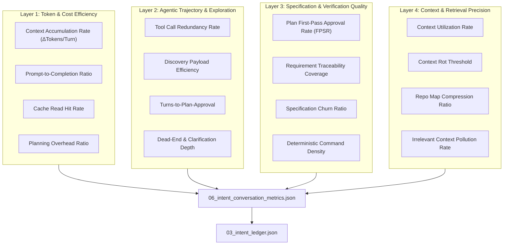
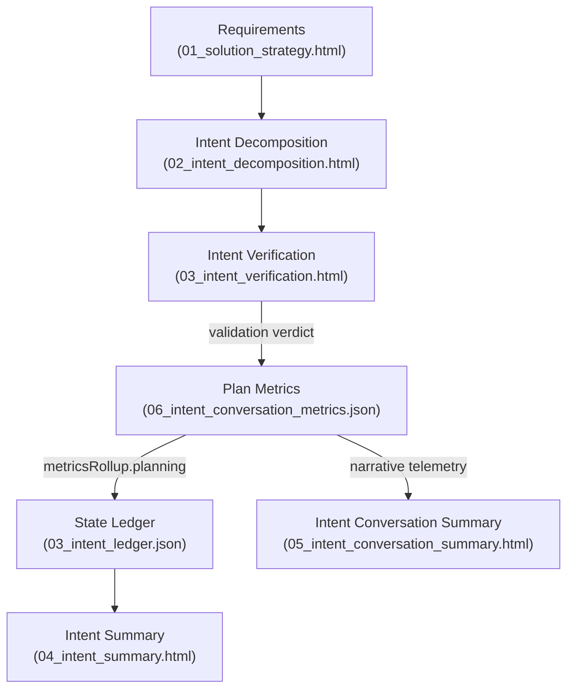

# Intent Conversation Metrics Document Definition

The Intent Conversation Metrics Document (`06_intent_conversation_metrics.json`) is the authoritative Tier 1 telemetry
record for planning. It is part of the work item lifecycle of `brevio` (Token Optimized Software Harness). It collects token use, model
latencies, tool invocations, context accumulation, and pre-execution validation outcomes. It covers the full planning
sub-intent before implementation starts.

In `brevio`, you cannot measure token optimization in isolation. If planning prunes tokens too early, requirements can
be under-specified, schemas can be hallucinated, or units can be ambiguous. These faults cause multi-turn repair loops
during execution, and each loop adds to the next. The loops greatly increase the total compute.

This document has two uses:

1. Human & Platform Interface: The document gives structured telemetry that you can audit. Engineering managers,
   platform teams, and developers use it to benchmark planning models and track API costs. They also use it to find
   bottlenecks in multi-agent debates and to assess planning efficiency.
2. Agent / Harness Interface: The document is a deterministic JSON artifact for machines. The `brevio` CLI and
   evaluation runners query it. They use it to adjust context-injection budgets, improve system prompts, and optimize
   prompt caching strategies for future work items.

---

## Core Planning Paradigm: The 4-Layer Planning Telemetry Framework

`brevio` organizes the telemetry of the planning conversation in four separate analysis layers. These layers give
signals from planning session transcripts that teams can act on:



---

## Table of Contents

1. [File Location & Organization Standard](#1-file-location--organization-standard)
2. [The 4-Layer Planning Telemetry Framework](#2-the-4-layer-planning-telemetry-framework)
    - 2.1. [Layer 1: Token & Cost Efficiency Metrics](#21-layer-1-token--cost-efficiency-metrics)
    - 2.2. [Layer 2: Agentic Trajectory & Tool Optimization](#22-layer-2-agentic-trajectory--tool-optimization)
    - 2.3. [Layer 3: Specification & Pre-Execution Quality](#23-layer-3-specification--pre-execution-quality)
    - 2.4. [Layer 4: Context & Retrieval Precision](#24-layer-4-context--retrieval-precision)
3. [JSON Schema Specification (
   `06_intent_conversation_metrics.json`)](#3-json-schema-specification-06_intent_conversation_metricsjson)
4. [Turn-Level Session Log Schema (`plan_conversation.jsonl`)](#4-turn-level-session-log-schema-plan_conversationjsonl)
5. [Token Optimization, Analysis Patterns & CLI / jq Queries](#5-token-optimization-analysis-patterns--cli--jq-queries)
6. [Lineage, Traceability & Ledger Integration](#6-lineage-traceability--ledger-integration)
7. [Rules & Constraints](#7-rules--constraints)
8. [Revisions](#8-revisions)

---

## 1. File Location & Organization Standard

The plan conversation metrics file is at the root of the work item directory, next to the core Tier 1 planning
documents:

```text
.brevio/
└── work_items/
    └── {YYYYMMDDTHHMMSSZ}_{work_item_slug}/
        ├── 00_intent_spec.html                # Originator's Intent (Frozen at Acceptance)
        ├── 01_solution_strategy.html                 # Requirements, Invariants, Evidence & Design
        ├── 02_intent_decomposition.html         # Implementation Plan & Sub-Intent DAG
        ├── 03_intent_ledger.json       # State Machine & Unit Dependency DAG
        ├── 03_intent_verification.html             # Pre-Execution Plan Gating Verdict
        ├── 04_intent_summary.html                # Execution Rollup Summary
        ├── 05_intent_conversation_summary.html   # Distilled Agent Dialogue & Decisions
        ├── 06_intent_conversation_metrics.json   # Authoritative Planning Telemetry
        └── sub_intents/
            └── ...
```

- File Name: `06_intent_conversation_metrics.json`
- Format: Strict JSON (UTF-8, 2-space indentation).
- Paired Log: `plan_conversation.jsonl` (or the memory store for the conversation) records the session turns.
- Summary Document: [`05_intent_conversation_summary.html`](intent-conversation-summary.md) contains the rendered
  narrative for people.

---

## 2. The 4-Layer Planning Telemetry Framework

### 2.1. Layer 1: Token & Cost Efficiency Metrics

These metrics detect prompt bloat, inefficient multi-agent routing, and runaway discovery loops during the planning
sub-intent.

| Metric Name                                     | Formula / Measurement                                                                                   | Target Range                         | Purpose & Harness Improvement Area                                                                                                                                                                                                       |
|:------------------------------------------------|:--------------------------------------------------------------------------------------------------------|:-------------------------------------|:-----------------------------------------------------------------------------------------------------------------------------------------------------------------------------------------------------------------------------------------|
| Context Accumulation Rate                       | $\Delta\text{Tokens} / \text{Turn} = \frac{\text{Prompt Tokens}_{N} - \text{Prompt Tokens}_{1}}{N - 1}$ | Linear slope ($< 1,500$ tokens/turn) | Measures how fast input tokens grow across planning exchanges. A steep or quadratic curve shows that the harness dumps full raw transcripts or unfiltered tool outputs. It does not prune them or keep a rolling state. |
| Prompt-to-Completion Ratio                      | $\frac{\text{Prompt Tokens}}{\text{Completion Tokens}}$                                                 | $70:30$ to $85:15$                   | Planning needs analytical output (ADRs, schemas, units). If the ratio exceeds $95:5$, the prompt templates contain too much irrelevant background, or the models give short, under-specified plans. |
| Token Cost per Planned Unit                     | $\frac{\text{Total Planning Tokens}}{\text{Total Planned Units Count}}$                                 | $< 8,000$ tokens/unit                | Gives the planning overhead for each planned unit of work. Shows architecture debates that are too long for the unit count.                                                                                                             |
| Cache Read Hit Rate                             | $\frac{\text{Cache Read Tokens}}{\text{Total Prompt Tokens}} \times 100\%$                              | $> 65\%$                             | Percentage of prompt tokens that prefix caching serves (for example, Anthropic Prompt Caching, OpenAI Cached Prompts). Makes sure that static system instructions, repository maps, and guidelines stay in a stable prefix order. |
| Planning Overhead Ratio *(Suggested)*           | $\frac{\text{Total Planning Tokens}}{\text{Estimated Total Execution Tokens}}$                          | $10\% - 25\%$                        | Measures whether the planning effort is in proportion to the execution scope. An overhead $> 40\%$ shows over-engineering. An overhead $< 5\%$ shows a high risk of failures during execution. |
| Prefix Cache Stability Factor *(Suggested)*     | $1 - \frac{\text{Cache Invalidation Events}}{\text{Total Turns}}$                                       | $\ge 0.90$                           | Makes sure that dynamic, short-lived context is always added at the end of the message array and does not break prefix cache blocks.                                                                                                 |

---

### 2.2. Layer 2: Agentic Trajectory & Tool Optimization

Planning overhead comes mainly from unfocused repository scans, redundant file inspection, and circular debates between
specialized planning agents (for example, PM, Architect, Security Auditor).

| Metric Name                               | Formula / Measurement                                                                 | Target Range           | Purpose & Harness Improvement Area                                                                                                                                                                                                         |
|:------------------------------------------|:--------------------------------------------------------------------------------------|:-----------------------|:-------------------------------------------------------------------------------------------------------------------------------------------------------------------------------------------------------------------------------------------|
| Tool Call Redundancy Rate                 | $\frac{\text{Duplicate Tool Invocations}}{\text{Total Tool Invocations}}$             | $\le 5\%$              | How often an agent calls the same tool with identical parameters (for example, it reads `pom.xml` or `package.json` 3 times with no changes). Harness scratchpads and stateful tool call caches correct this. |
| Discovery Payload Efficiency              | $\frac{\text{Tokens Referenced in Specs}}{\text{Tokens Returned by Discovery Tools}}$ | $\ge 25\%$             | Ratio of the tokens that exploration tools (`grep`, `find_by_name`, `view_file`) return to the tokens that `01_solution_strategy.html` or `02_intent_decomposition.html` actually cite. A low ratio shows the need for AST views and line-bounded reads. |
| Turns-to-Plan-Approval                    | Total LLM turns to reach an approved plan                                             | $\le 12$ turns         | Round trips needed from requirement ingestion until `03_intent_verification.html` passes. Detects agent hesitation, circular debate, or unclear requirements.                                                                             |
| Dead-End & Clarification Depth            | Consecutive turns spent to resolve schema or constraint errors                        | $\le 2$ turns          | Turns spent to recover from invalid unit JSON, malformed schema definitions, or contradictory requirements. Target improvement: strict JSON schema enforcement in tool calls.                                                            |
| Discovery Fan-Out Ratio *(Suggested)*     | $\frac{\text{Candidate Files Inspected}}{\text{Files Targeted in Unit Specs}}$        | $2.0 - 4.0$            | Tracks the focus of the search. If an agent inspects 80 files to plan changes to 2 files (ratio $40.0$), repository indexing or RAG ranking pulls in irrelevant files.                                                                    |
| Agent Handoff Friction *(Suggested)*      | $\frac{\text{Handoff Summary Tokens}}{\text{Total Multi-Agent Turns}}$                | $< 500$ tokens/handoff | In multi-agent harnesses, measures the token cost to transfer context between Planner, Architect, and Validator agents.                                                                                                                   |

---

### 2.3. Layer 3: Specification & Pre-Execution Quality

To be successful, a planning conversation produces specifications that are reliable, testable, and dependency-sound.

| Metric Name                                     | Formula / Measurement                                                                         | Target Range               | Purpose & Harness Improvement Area                                                                                                                          |
|:------------------------------------------------|:----------------------------------------------------------------------------------------------|:---------------------------|:------------------------------------------------------------------------------------------------------------------------------------------------------------|
| Plan First-Pass Approval Rate (FPSR)            | `03_intent_verification.html` passes on the first validation run                              | $100\%$ ($1.0$)            | Evaluates whether the first plan satisfied all feasibility, security, and architecture checks with no rework turns.                                         |
| Specification Churn Ratio                       | $\frac{\text{Revised Plan Section Lines}}{\text{Net Accepted Plan Lines}}$                    | $\le 1.15$                 | High churn shows that the planner switched between architectures or hallucinated APIs. These needed much revision before the plan passed validation.        |
| Requirement Traceability Coverage               | $\frac{\text{Mapped Requirement IDs}}{\text{Total Itemized Requirement IDs}} \times 100\%$    | $100\%$                    | Makes sure that every requirement in `01_solution_strategy.html` (`EV-###`) is assigned to at least one unit in `02_intent_decomposition.html`.              |
| Dependency DAG Soundness                        | Graph validation boolean & cycle count                                                        | Cycles: `0`, Orphaned: `0` | Evaluates whether the unit dependencies in `03_intent_ledger.json` form a valid Directed Acyclic Graph with balanced breadth and depth.                     |
| Deterministic Command Density *(Suggested)*     | $\frac{\text{Units with Exact Shell Verifications}}{\text{Total Planned Units}} \times 100\%$ | $100\%$                    | Makes sure that 100% of planned units declare explicit shell commands for verification, with expected exit codes (`0`), not subjective manual review steps. |
| Edge Case Density *(Suggested)*                 | $\frac{\text{Total Itemized Edge Cases (EC-###)}}{\text{Total Planned Units}}$                | $\ge 2.0$ edge cases/unit  | Makes sure that the planning agents anticipated negative paths and boundary hazards before implementation.                                                  |

---

### 2.4. Layer 4: Context & Retrieval Precision

Planning agents often query repository documentation, OpenAPI specs, and existing source trees. An evaluation of how
relevant the ingested context is prevents prompt poisoning and loss of quality in the context window.

| Metric Name                                         | Formula / Measurement                                                                                           | Target Range                | Purpose & Harness Improvement Area                                                                                                                                                           |
|:----------------------------------------------------|:----------------------------------------------------------------------------------------------------------------|:----------------------------|:---------------------------------------------------------------------------------------------------------------------------------------------------------------------------------------------|
| Context Utilization Rate                            | $\frac{\text{Retrieved Code/Doc Snippets Cited in Specs}}{\text{Total Injected Context Snippets}} \times 100\%$ | $\ge 60\%$                  | Percentage of retrieved workspace files, wiki pages, or class definitions that directly inform the solution strategy. A low rate shows poor RAG embeddings or broad wildcard file injections. |
| Context Rot Threshold                               | Token depth at which the recall of the agent becomes worse                                                      | $> 90\%$ of window limit    | Tracks the token level at which the agent starts to hallucinate classes that do not exist, forget negative constraints, or drop requirement IDs. Triggers automatic summarization turns.     |
| Repo Map Compression Ratio *(Suggested)*            | $\frac{\text{Uncompressed Directory Tokens}}{\text{Compact Symbol Map Tokens}}$                                 | $\ge 5.0\times$ compression | Ratio of the raw file tree to the semantic symbol map that the planning prompt receives.                                                                                                     |
| Irrelevant Context Pollution Rate *(Suggested)*     | $\frac{\text{Injected Files Unrelated to Domain}}{\text{Total Injected Files}} \times 100\%$                    | $\le 5\%$                   | Measures false positives in codebase retrieval that pollute the reasoning of the planner.                                                                                                   |

---

## 3. JSON Schema Specification (`06_intent_conversation_metrics.json`)

This JSON Schema defines the structure and validation of `06_intent_conversation_metrics.json`:

```json
{
  "$schema": "https://json-schema.org/draft/2020-12/schema",
  "$id": "https://brevio.dev/schemas/work-items/plan-conversation-metrics.schema.json",
  "title": "PlanConversationMetrics",
  "description": "Authoritative Tier 1 planning conversation metrics and telemetry record.",
  "type": "object",
  "required": [
    "docId",
    "docType",
    "schemaVersion",
    "workItemId",
    "status",
    "timestamps",
    "tokenEfficiency",
    "agenticTrajectory",
    "specificationQuality",
    "contextEngineering",
    "costRollup",
    "modelUsageBreakdown"
  ],
  "properties": {
    "docId": {
      "type": "string",
      "pattern": "^WI-[0-9]{8}T[0-9]{6}Z:METRICS$"
    },
    "docType": {
      "type": "string",
      "const": "plan-conversation-metrics"
    },
    "schemaVersion": {
      "type": "string",
      "const": "1.0.0"
    },
    "workItemId": {
      "type": "string",
      "pattern": "^[0-9]{8}T[0-9]{6}Z_[a-z0-9_]+$"
    },
    "status": {
      "type": "string",
      "enum": [
        "pending",
        "in-progress",
        "completed",
        "failed"
      ]
    },
    "timestamps": {
      "type": "object",
      "required": [
        "startedAt",
        "completedAt",
        "durationMs"
      ],
      "properties": {
        "startedAt": {
          "type": "string",
          "format": "date-time"
        },
        "completedAt": {
          "type": "string",
          "format": "date-time"
        },
        "durationMs": {
          "type": "integer",
          "minimum": 0
        }
      }
    },
    "tokenEfficiency": {
      "type": "object",
      "required": [
        "totalTokens",
        "promptTokens",
        "completionTokens",
        "cacheReadTokens",
        "cacheCreationTokens",
        "cacheReadHitRatePct",
        "promptToCompletionRatio",
        "contextAccumulationRateDeltaPerTurn",
        "tokenCostPerPlannedTask"
      ],
      "properties": {
        "totalTokens": {
          "type": "integer",
          "minimum": 0
        },
        "promptTokens": {
          "type": "integer",
          "minimum": 0
        },
        "completionTokens": {
          "type": "integer",
          "minimum": 0
        },
        "cacheReadTokens": {
          "type": "integer",
          "minimum": 0
        },
        "cacheCreationTokens": {
          "type": "integer",
          "minimum": 0
        },
        "cacheReadHitRatePct": {
          "type": "number",
          "minimum": 0,
          "maximum": 100
        },
        "promptToCompletionRatio": {
          "type": "string"
        },
        "contextAccumulationRateDeltaPerTurn": {
          "type": "number"
        },
        "tokenCostPerPlannedTask": {
          "type": "number",
          "minimum": 0
        },
        "planningOverheadRatio": {
          "type": "number",
          "minimum": 0
        }
      }
    },
    "agenticTrajectory": {
      "type": "object",
      "required": [
        "totalTurns",
        "totalToolCalls",
        "toolCallRedundancyRatePct",
        "toolPayloadEfficiencyPct",
        "deadEndTurnsCount",
        "discoveryFanOutRatio"
      ],
      "properties": {
        "totalTurns": {
          "type": "integer",
          "minimum": 1
        },
        "totalToolCalls": {
          "type": "integer",
          "minimum": 0
        },
        "toolCallRedundancyRatePct": {
          "type": "number",
          "minimum": 0,
          "maximum": 100
        },
        "toolPayloadEfficiencyPct": {
          "type": "number",
          "minimum": 0,
          "maximum": 100
        },
        "deadEndTurnsCount": {
          "type": "integer",
          "minimum": 0
        },
        "discoveryFanOutRatio": {
          "type": "number",
          "minimum": 0
        },
        "agentParticipantsCount": {
          "type": "integer",
          "minimum": 1
        }
      }
    },
    "specificationQuality": {
      "type": "object",
      "required": [
        "planFirstPassApproval",
        "planValidationIterations",
        "requirementTraceabilityPct",
        "totalRequirementsPlanned",
        "totalPhasesPlanned",
        "totalTasksPlanned",
        "deterministicCommandDensityPct",
        "edgeCaseDensity"
      ],
      "properties": {
        "planFirstPassApproval": {
          "type": "boolean"
        },
        "planValidationIterations": {
          "type": "integer",
          "minimum": 1
        },
        "requirementTraceabilityPct": {
          "type": "number",
          "minimum": 0,
          "maximum": 100
        },
        "totalRequirementsPlanned": {
          "type": "integer",
          "minimum": 1
        },
        "totalPhasesPlanned": {
          "type": "integer",
          "minimum": 1
        },
        "totalTasksPlanned": {
          "type": "integer",
          "minimum": 1
        },
        "deterministicCommandDensityPct": {
          "type": "number",
          "minimum": 0,
          "maximum": 100
        },
        "edgeCaseDensity": {
          "type": "number",
          "minimum": 0
        },
        "specificationChurnRatio": {
          "type": "number",
          "minimum": 1.0
        }
      }
    },
    "contextEngineering": {
      "type": "object",
      "required": [
        "contextUtilizationRatePct",
        "maxTurnTokenDepth",
        "contextRotDetected",
        "injectedFilesCount",
        "citedFilesCount"
      ],
      "properties": {
        "contextUtilizationRatePct": {
          "type": "number",
          "minimum": 0,
          "maximum": 100
        },
        "maxTurnTokenDepth": {
          "type": "integer",
          "minimum": 0
        },
        "contextRotDetected": {
          "type": "boolean"
        },
        "injectedFilesCount": {
          "type": "integer",
          "minimum": 0
        },
        "citedFilesCount": {
          "type": "integer",
          "minimum": 0
        },
        "repoMapCompressionRatio": {
          "type": "number",
          "minimum": 1.0
        }
      }
    },
    "costRollup": {
      "type": "object",
      "required": [
        "totalCostUsd",
        "currency"
      ],
      "properties": {
        "totalCostUsd": {
          "type": "number",
          "minimum": 0
        },
        "currency": {
          "type": "string",
          "const": "USD"
        }
      }
    },
    "modelUsageBreakdown": {
      "type": "array",
      "items": {
        "type": "object",
        "required": [
          "model",
          "role",
          "turns",
          "promptTokens",
          "completionTokens",
          "cacheReadTokens",
          "costUsd"
        ],
        "properties": {
          "model": {
            "type": "string"
          },
          "role": {
            "type": "string"
          },
          "turns": {
            "type": "integer",
            "minimum": 1
          },
          "promptTokens": {
            "type": "integer",
            "minimum": 0
          },
          "completionTokens": {
            "type": "integer",
            "minimum": 0
          },
          "cacheReadTokens": {
            "type": "integer",
            "minimum": 0
          },
          "costUsd": {
            "type": "number",
            "minimum": 0
          }
        }
      }
    }
  },
  "additionalProperties": false
}
```

### 3.1. Concrete Instance Example (`06_intent_conversation_metrics.json`)

```json
{
  "docId": "WI-20260830T170936Z:METRICS",
  "docType": "plan-conversation-metrics",
  "schemaVersion": "1.0.0",
  "workItemId": "20260830T170936Z_user_auth_service",
  "status": "completed",
  "timestamps": {
    "startedAt": "2026-08-30T17:09:36Z",
    "completedAt": "2026-08-30T17:15:20Z",
    "durationMs": 344000
  },
  "tokenEfficiency": {
    "totalTokens": 45200,
    "promptTokens": 32100,
    "completionTokens": 13100,
    "cacheReadTokens": 22400,
    "cacheCreationTokens": 4800,
    "cacheReadHitRatePct": 69.78,
    "promptToCompletionRatio": "71:29",
    "contextAccumulationRateDeltaPerTurn": 1120.5,
    "tokenCostPerPlannedTask": 3766.6,
    "planningOverheadRatio": 0.14
  },
  "agenticTrajectory": {
    "totalTurns": 10,
    "totalToolCalls": 18,
    "toolCallRedundancyRatePct": 0.0,
    "toolPayloadEfficiencyPct": 38.4,
    "deadEndTurnsCount": 0,
    "discoveryFanOutRatio": 2.25,
    "agentParticipantsCount": 2
  },
  "specificationQuality": {
    "planFirstPassApproval": true,
    "planValidationIterations": 1,
    "requirementTraceabilityPct": 100.0,
    "totalRequirementsPlanned": 8,
    "totalPhasesPlanned": 3,
    "totalTasksPlanned": 12,
    "deterministicCommandDensityPct": 100.0,
    "edgeCaseDensity": 2.5,
    "specificationChurnRatio": 1.04
  },
  "contextEngineering": {
    "contextUtilizationRatePct": 78.2,
    "maxTurnTokenDepth": 18450,
    "contextRotDetected": false,
    "injectedFilesCount": 9,
    "citedFilesCount": 7,
    "repoMapCompressionRatio": 6.8
  },
  "costRollup": {
    "totalCostUsd": 0.1356,
    "currency": "USD"
  },
  "modelUsageBreakdown": [
    {
      "model": "claude-3-7-sonnet",
      "role": "lead-architect",
      "turns": 6,
      "promptTokens": 19400,
      "completionTokens": 8200,
      "cacheReadTokens": 14200,
      "costUsd": 0.0882
    },
    {
      "model": "claude-3-5-haiku",
      "role": "codebase-explorer",
      "turns": 4,
      "promptTokens": 12700,
      "completionTokens": 4900,
      "cacheReadTokens": 8200,
      "costUsd": 0.0474
    }
  ]
}
```

---

## 4. Turn-Level Session Log Schema (`plan_conversation.jsonl`)

The planning session logger writes atomic JSON lines for every exchange. These lines let tools compute the metrics
deterministically:

```json
{
  "session_id": "sess-plan-20260830T170936Z",
  "turn_index": 4,
  "role": "assistant",
  "agent_role": "lead-architect",
  "model": "claude-3-7-sonnet",
  "timestamp": "2026-08-30T17:11:42Z",
  "usage": {
    "prompt_tokens": 14250,
    "completion_tokens": 820,
    "cache_read_tokens": 10500,
    "cache_creation_tokens": 0
  },
  "tool_calls": [
    {
      "name": "view_file",
      "args": {
        "path": "src/main/resources/application.yml"
      },
      "args_tokens": 42,
      "response_tokens": 310,
      "status": "success",
      "is_retry": false,
      "tokens_referenced_in_turn": 125
    }
  ],
  "verification": {
    "plan_section_drafted": "01_solution_strategy.html#architecture",
    "requirements_referenced": [
      "EV-001",
      "EV-002"
    ],
    "syntax_valid": true,
    "validation_errors": 0
  },
  "context_stats": {
    "injected_files_count": 3,
    "active_scratchpad_tokens": 620,
    "total_context_depth": 14250
  }
}
```

---

## 5. Token Optimization, Analysis Patterns & CLI / jq Queries

The `brevio` CLI and CI/CD pipelines use deterministic `jq` queries against `06_intent_conversation_metrics.json` and
`plan_conversation.jsonl` to detect planning inefficiencies:

### 5.1. Detecting Runaway Context Accumulation Rate

```bash
# Query delta tokens between turn 1 and last turn in session log
jq -s '
  (.[-1].usage.prompt_tokens - .[0].usage.prompt_tokens) / (length - 1)
' plan_conversation.jsonl
```

### 5.2. Calculating Planning Cache Read Hit Rate

```bash
# Verify prefix cache efficacy across planning session
jq '
  .tokenEfficiency.cacheReadHitRatePct
' 06_intent_conversation_metrics.json
```

### 5.3. Flagging Discovery Payload Inefficiency

```bash
# Identify tool calls where response tokens greatly exceeded referenced tokens
jq -c '
  select(.tool_calls[]? | .response_tokens > 1000 and (.tokens_referenced_in_turn / .response_tokens) < 0.10)
  | {turn: .turn_index, tool: .tool_calls[0].name, returned: .tool_calls[0].response_tokens, referenced: .tool_calls[0].tokens_referenced_in_turn}
' plan_conversation.jsonl
```

### 5.4. Validating 100% Deterministic Command Density

```bash
# Gating rule: Assert all planned units have deterministic terminal validation
jq -e '
  .specificationQuality.deterministicCommandDensityPct == 100.0
' 06_intent_conversation_metrics.json
```

---

## 6. Lineage, Traceability & Ledger Integration

The plan metrics file is part of the two-way lineage graph of the work item:



- Upward Pointers: `docId` refers to the work item root (`WI-{timestamp}:METRICS`). `workItemId` anchors to the root
  directory.
- Narrative Binding: [`05_intent_conversation_summary.html`](intent-conversation-summary.md) summarizes the detailed
  exchanges and trade-offs of the conversation. It links directly to `06_intent_conversation_metrics.json`.
- Ledger Rollup: The key totals (`totalTokens`, `totalCostUsd`, `cacheReadHitRatePct`) are copied into the
  `metricsRollup` object of [`03_intent_ledger.json`](intent-ledger.md).

---

## 7. Rules & Constraints

1. Immutable Historical Telemetry: After `03_intent_verification.html` records `pass` and sub-intent execution starts,
   `06_intent_conversation_metrics.json` is frozen. It must not be changed.
2. Deterministic Token Counts: All token metrics must come directly from the usage metadata in LLM API responses (or
   from calibrated model tokenizers). They must not come from rough word-count heuristics.
3. Prefix Stability Enforcement: System prompts and static guidelines must come first in prompts, to maximize
   `cacheReadHitRatePct`. Ephemeral session messages must never come before cached system blocks.
4. Tool Redundancy Ceiling: If a planning session shows `toolCallRedundancyRatePct > 10%`, the session must trigger a
   lint warning in `brevio plan validate`. The warning flags defective tool usage loops.
5. Universal Traceability: Before planning closes, the `requirementTraceabilityPct` metric must account for 100% of
   functional requirements (`EV-###`).

---

## 8. Revisions

| Date       | Version | Description                                                                                                                                                                                                | Source                 |
|:-----------|:--------|:-----------------------------------------------------------------------------------------------------------------------------------------------------------------------------------------------------------|:-----------------------|
| 2026-11-25 | 1.2.1 | Rewrote the prose in plain English. No change to the design. | User request |
| 2026-11-25 | 1.2.0 | Evidence requirements now come from the solution strategy. | TOPIC-007 |
| 2026-10-31 | 1.1.0 | Moved to the intent-based document set: intent, sub-intent, and unit terminology, convergence states, required target scope, and evidence requirement IDs. | TOPIC-005 |
| 2026-09-06 | 1.0.0   | Authoritative specification for Intent Conversation Metrics (`06_intent_conversation_metrics.json`) establishing the 4-layer telemetry framework, JSON schema, session log contract, and jq analysis patterns. | Feature Specification  |
| 2026-08-30 | 0.1.0   | Initial baseline stub in metadata definition.                                                                                                                                                              | Architecture Alignment |