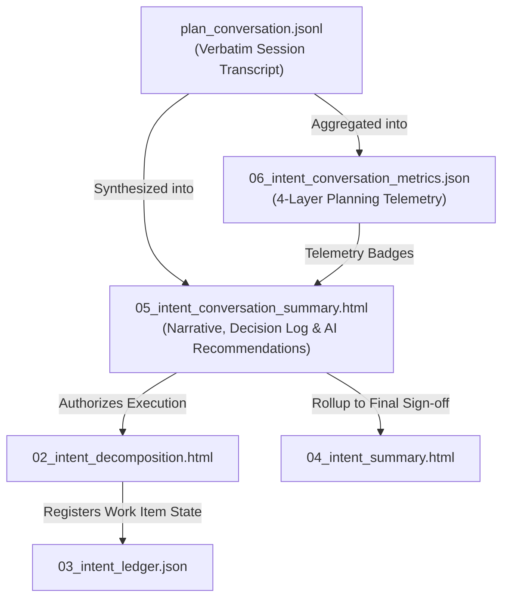

# Intent Conversation Summary Document Definition

The Intent Conversation Summary Document (`05_intent_conversation_summary.html`) is the authoritative Tier 1 narrative
summary of planning. `brevio` (Token Optimized Software Harness) writes it after planning in the work item lifecycle. It
summarizes
the multi-agent LLM dialogue, the architecture debates, the trade-off analyses, and the alignment rounds. These produced
the intent ([`00_intent_spec.html`](intent-specification.md)), the requirements and technical design
([`01_solution_strategy.html`](solution-strategy.md)), and the implementation roadmap
([`02_intent_decomposition.html`](intent-decomposition.md)).

[`06_intent_conversation_metrics.json`](intent-conversation-metrics.md) records detailed telemetry for each turn (token
counts, latencies, tool execution arrays). `plan_conversation.jsonl` keeps the raw interaction stream.
`05_intent_conversation_summary.html` gives the evaluation of how well planning worked, in a form that people can read.
It summarizes the high-level telemetry, reviews the performance of the conversation, and identifies friction points. It
also gives targeted recommendations to improve the AI components that took part.

This document has two uses:

1. Human Interface (Static UI): The document renders as a local, interactive, static XHTML web page. It uses Material
   Design 3 Web Components (`@material/web`, M3). Engineering leaders and developers review decision timelines,
   high-level economic KPIs, evaluations of multi-agent collaboration, and specific tuning suggestions for AI
   components. The page needs no client-side bundler or runtime server.
2. Agent / Harness Interface (Machine Parseable): The document is a structured XML document. You can query it with XPath
   and the `brevio` CLI. Evaluation harnesses and orchestrators read the performance ratings of the conversation, the
   token benchmarks, and the AI component recommendations. They use them to tune model selection, prompt templates, and
   the configuration of agent skills for future work items.

---

## Core Paradigm: Applying the Four Dimensions to Intent Conversation Summaries

In `brevio`, the plan conversation summary evaluates the planning work against the four basic dimensions:

| Dimension       | Human Engineer Focus                                                                  | AI Coding Tool Focus                                                                              | `brevio` Intent Conversation Summary Manifestation                                                                                                                                                                                                    |
|:----------------|:--------------------------------------------------------------------------------------|:--------------------------------------------------------------------------------------------------|:--------------------------------------------------------------------------------------------------------------------------------------------------------------------------------------------------------------------------------------------------|
| Context         | Uses unwritten codebase conventions and domain knowledge that the team shares.        | Needs explicit file paths, referenced patterns, and strict "do not touch" constraints.            | Audits how precisely agents retrieved context and explored the repository during planning. Makes sure that agents based their designs on real codebase facts, without prompt bloat.                                                             |
| Granularity     | Focuses on high-level patterns and architecture. Details wait until implementation.   | Needs atomic sub-units with one responsibility each and deterministic inputs and outputs.         | Evaluates whether the multi-agent dialogue stayed focused and moved forward. Circular debates and monolithic requirements are absent, and atomic sub-intent milestones are present.                                                                    |
| Verification    | Manual PR review, local exploratory debugging, automated CI.                          | Explicit terminal commands after each step (lint, test, build), with deterministic parsing of the output. | Reviews the dialogue that led into pre-execution intent verification ([`03_intent_verification.html`](intent-verification.md)). Certifies that all gates passed on the first pass (FPSR).                                                   |
| Edge Cases      | Usually found through intuitive testing or code review cycles.                        | Must be listed in full before the work starts, to prevent naive happy-path assumptions.           | Records how well the participants in the conversation found adversarial edge cases, schema boundary failures, and security risks during the planning debates.                                                                                  |

---

## Table of Contents

1. [File Location & Organization Standard](#1-file-location--organization-standard)
2. [XHTML Header & Metadata Standard](#2-xhtml-header--metadata-standard)
    - 2.1. [XHTML Header Example](#21-xhtml-header-example)
    - 2.2. [Metadata Attribute Contracts](#22-metadata-attribute-contracts)
3. [Required Sections & M3 Component Structure](#3-required-sections--m3-component-structure)
    - 3.1. [Document Header & Metadata Bar](#31-document-header--metadata-bar)
    -
    3.2. [Executive Planning Dialogue Synthesis & Decision Log](#32-executive-planning-dialogue-synthesis--decision-log)
    - 3.3. [High-Level Planning Telemetry & Metrics Rollup](#33-high-level-planning-telemetry--metrics-rollup)
    -
    3.4. [LLM Conversational Performance & Trajectory Analysis](#34-llm-conversational-performance--trajectory-analysis)
    - 3.5. [Conversational Friction & Inefficiency Post-Mortem](#35-conversational-friction--inefficiency-post-mortem)
    - 3.6. [Suggested Improvements to AI Components](#36-suggested-improvements-to-ai-components)
        - 3.6.1. [Model Selection, Routing & Right-Sizing](#361-model-selection-routing--right-sizing)
        -
        3.6.2. [Agent Personas, System Prompts & Delegation Protocols](#362-agent-personas-system-prompts--delegation-protocols)
        - 3.6.3. [Custom Skills & Procedural Guidance Packages](#363-custom-skills--procedural-guidance-packages)
        - 3.6.4. [Coding Tools & MCP Server Ergonomics](#364-coding-tools--mcp-server-ergonomics)
        - 3.6.5. [Prompt Caching & Prefix Stability Optimization](#365-prompt-caching--prefix-stability-optimization)
    -
    3.7. [Downstream Execution Handoff & Plan Approval Sign-off](#37-downstream-execution-handoff--plan-approval-sign-off)
4. [Token Optimization & XPath Query Patterns](#4-token-optimization--xpath-query-patterns)
5. [Lineage, Rollup & Ledger Integration](#5-lineage-rollup--ledger-integration)
6. [Rules & Constraints](#6-rules--constraints)
7. [Revisions](#7-revisions)

---

## 1. File Location & Organization Standard

The plan conversation summary document is at the root of the work item directory, next to the core Tier 1 planning
artifacts:

```text
.brevio/
└── work_items/
    └── {YYYYMMDDTHHMMSSZ}_{work_item_slug}/
        ├── 00_intent_spec.html                # Originator's Intent (Frozen at Acceptance)
        ├── 01_solution_strategy.html                 # Requirements, Invariants, Evidence & Design
        ├── 02_intent_decomposition.html         # Implementation Plan & Sub-Intent DAG
        ├── 03_intent_ledger.json       # State Machine & Unit Dependency DAG
        ├── 03_intent_verification.html             # Pre-Execution Plan Gating Verdict
        ├── 04_intent_summary.html                # Execution Rollup Summary
        ├── 05_intent_conversation_summary.html   # Authoritative Planning Dialogue Synthesis
        ├── 06_intent_conversation_metrics.json   # Authoritative Planning Telemetry
        └── sub_intents/
            └── ...
```

- File Name: `05_intent_conversation_summary.html`
- Format: Strict XHTML (`application/xhtml+xml` compliant, standard XML syntax).
- Encoding: UTF-8.
- Runtime: Fully static. The file runs directly in modern browsers from the local file system (`file://`), or the
  `brevio` CLI serves it locally.
- Paired Artifacts:
    - Intent Specification: [`00_intent_spec.html`](intent-specification.md)
    - Solution Strategy: [`01_solution_strategy.html`](solution-strategy.md)
    - Implementation Roadmap: [`02_intent_decomposition.html`](intent-decomposition.md)
    - Intent Verification Gate: [`03_intent_verification.html`](intent-verification.md)
    - Full Telemetry: [`06_intent_conversation_metrics.json`](intent-conversation-metrics.md)
    - Verbatim Transcript: `plan_conversation.jsonl` (or the session store for the conversation)

---

## 2. XHTML Header & Metadata Standard

### 2.1. XHTML Header Example

Every `05_intent_conversation_summary.html` starts with the universal baseline `<meta>` tags, the planning dialogue
metrics, the participant lists, and the Material Web ES module importmap loader:

```xhtml
<!DOCTYPE html>
<html xmlns="http://www.w3.org/1999/xhtml" lang="en">
<head>
    <meta charset="UTF-8"/>
    <meta name="viewport" content="width=device-width, initial-scale=1.0"/>
    <title>PLAN CONVERSATION SUMMARY: User Authentication Service</title>

    <!-- Universal Baseline Metadata -->
    <meta name="doc-id" content="WI-20260830T170936Z:05:CONV-SUM"/>
    <meta name="doc-type" content="plan-conversation-summary"/>
    <meta name="schema-version" content="1.0.0"/>
    <meta name="domain" content="work-items"/>
    <meta name="intent-id" content="20260830T170936Z_user_auth_service"/>
    <meta name="status" content="completed"/> <!-- pending | in-progress | completed | failed | blocked -->
    <meta name="created-at" content="2026-08-30T17:45:00Z"/>
    <meta name="updated-at" content="2026-08-30T17:48:15Z"/>

    <!-- Intent Conversation Summary Domain Metadata -->
    <meta name="parent-doc-id" content="WI-20260830T170936Z:02:DECOMP"/>
    <meta name="metrics-ref" content="06_intent_conversation_metrics.json"/>
    <meta name="agent-participants"
          content="agent:orchestrator,agent:architect,agent:security-auditor,agent:database-specialist"/>
    <meta name="turn-count" content="18"/>
    <meta name="planning-duration-ms" content="48200"/>
    <meta name="total-tokens" content="45200"/>
    <meta name="total-cost-usd" content="0.1356"/>
    <meta name="conversation-verdict" content="approved"/> <!-- approved | reworked | escalated -->
    <meta name="fpsr" content="1.0"/> <!-- 1.0 (pass on first attempt) | 0.0 (required rework) -->

    <!-- Material Design 3 Web Component Loader -->
    <link href="https://fonts.googleapis.com/css2?family=Roboto:wght@400;500;700&amp;display=swap" rel="stylesheet"/>
    <link href="https://fonts.googleapis.com/css2?family=Material+Symbols+Outlined" rel="stylesheet"/>
    <script type="importmap">
        {
          "imports": {
            "@material/web/": "https://esm.run/@material/web/"
          }
        }
    </script>
    <script type="module">
        import '@material/web/all.js';
        import {styles as typescaleStyles} from '@material/web/typography/md-typescale-styles.js';

        document.adoptedStyleSheets.push(typescaleStyles.styleSheet);
    </script>
</head>
<body>
<main class="brevio-doc-container">
    <!-- Structured Document Body -->
</main>
</body>
</html>
```

### 2.2. Metadata Attribute Contracts

| Metadata Tag           | Scope               | Purpose                                                              | Example                                 |
|:-----------------------|:--------------------|:---------------------------------------------------------------------|:----------------------------------------|
| `parent-doc-id`        | Work Item / Summary | Points to the `doc-id` of the parent Intent Decomposition            | `WI-20260830T170936Z:02:DECOMP`           |
| `metrics-ref`          | Work Item / Summary | Relative path to the Intent Conversation Metrics JSON                | `06_intent_conversation_metrics.json`     |
| `agent-participants`   | Work Item / Summary | Comma-delimited list of all AI agent roles that took part in planning | `agent:orchestrator,agent:architect`    |
| `turn-count`           | Work Item / Summary | Total round-trip turns of the conversation across all participants   | `18`                                    |
| `planning-duration-ms` | Work Item / Summary | Total elapsed wall-clock time for the planning sub-intent, in milliseconds | `48200`                                 |
| `total-tokens`         | Work Item / Summary | Total tokens spent across all planning exchanges                     | `45200`                                 |
| `total-cost-usd`       | Work Item / Summary | Estimated money spent on the API for planning, in USD                | `0.1356`                                |
| `conversation-verdict` | Work Item / Summary | Class of the final outcome of the planning conversation             | `approved` \| `reworked` \| `escalated` |
| `fpsr`                 | Work Item / Summary | First-Pass Success Rate for pre-execution intent verification        | `1.0` \| `0.0`                          |

---

## 3. Required Sections & M3 Component Structure

The Intent Conversation Summary document contains 7 standardized sections. Each section uses semantic XHTML elements and
Material Design 3 Web Components (`md-*`). It also uses typography scale classes (`md-typescale-*`) and explicit data
attributes (`data-*`).

### 3.1. Document Header & Metadata Bar

This section starts the summary. It shows the work item identification, the status chip (`completed`), and the
conversation verdict chip (`approved`). It shows badges for duration, total tokens, and money spent. It also gives quick navigation links
back to [`02_intent_decomposition.html`](intent-decomposition.md) and
[`06_intent_conversation_metrics.json`](intent-conversation-metrics.md).

### 3.2. Executive Planning Dialogue Synthesis & Decision Log

This section summarizes the main path of the planning session. It explains how the user requirements became a validated
engineering roadmap:

- Executive Dialogue Narrative: A short summary of how the agents stated the problem, reached architecture consensus, and
  raised the main risks.
- Chronological Dialogue Milestone Timeline:
    1. Stage 1: Requirements Ingestion & Scope Clarification (Turns 1–4): The agents read the user prompt, queried
       the existing wiki standards, and resolved unclear auth requirements (Argon2id hashing vs bcrypt).
    2. Stage 2: Architectural Modeling & Trade-off Analysis (Turns 5–10): The architect agent debated token storage
       strategies (stateless JWT vs stateful Redis revocation) and drafted Micro-ADR-001.
    3. Stage 3: Work Breakdown & Sub-Intent Decomposition (Turns 11–14): The agents divided execution into 3
       separate sub-intents and 9 atomic units with deterministic prerequisites.
    4. Stage 4: Security & Validation Gating (Turns 15–16): The Security Auditor agent inspected target files and
       made sure that the password storage complied with OWASP.
    5. Stage 5: Plan Approval & Document Synthesis (Turns 17–18): The pre-execution validation suite ran.
       `03_intent_verification.html` recorded `pass`.
- Architectural Decisions & Trade-offs Log:

| Decision ID | Domain / Scope   | Adopted Architecture           | Rejected Alternative    | Core Rationale                                              | Deciding Agent              |
|:------------|:-----------------|:-------------------------------|:------------------------|:------------------------------------------------------------|:----------------------------|
| `ADR-001`   | Password Hashing | Argon2id ($m=65536, t=3, p=4$) | PBKDF2 / BCrypt         | OWASP 2026 recommended baseline for password storage        | `agent:security-auditor`    |
| `ADR-002`   | Token Revocation | DB-backed refresh token table  | In-memory Redis cluster | Adds no new infrastructure dependency in Sub-Intent 1       | `agent:architect`           |
| `ADR-003`   | Schema Migration | Flyway versioned SQL           | Hibernate auto-ddl      | Gives deterministic schema states in CI that you can audit  | `agent:database-specialist` |

### 3.3. High-Level Planning Telemetry & Metrics Rollup

This section shows a scorecard of planning economics for executives. It shows high-level KPIs that link directly to
[`06_intent_conversation_metrics.json`](intent-conversation-metrics.md):

```
┌─────────────────────────────────────────────────────────────────────────────────────────────┐
│ HIGH-LEVEL PLANNING TELEMETRY SCORECARD                                                     │
├───────────────────┬───────────────────┬───────────────────┬───────────────────┬─────────────┤
│ Total Tokens      │ Cache Read Rate   │ Planning Cost     │ Planning Overhead │ Turns       │
│ 45,200            │ 78.4%             │ $0.1356 USD       │ 14.2%             │ 18 turns    │
│ (32.1k In / 13.1k)│ (Prefix Hit)      │ (Blended)         │ (vs Exec Est.)    │ (FPSR: 1.0) │
└───────────────────┴───────────────────┴───────────────────┴───────────────────┴─────────────┘
```

- Total Token Breakdown: Input prompt tokens (32,100), completion tokens (13,100), and cached prompt tokens (25,160).
- Economic Efficiency: Total money spent ($0.1356) and cost for each planned unit ($0.0151 / unit).
- Prompt Caching Effectiveness: A high cache read rate (78.4%). This proves that system prompts, tool schemas, and
  repository maps kept stable prefix positions.
- Overhead Assessment: Planning compute was 14.2% of the estimated execution tokens. This is inside the healthy target
  window of 10%–25%.

### 3.4. LLM Conversational Performance & Trajectory Analysis

This section gives a strict qualitative and quantitative evaluation of how well the planning session worked as an LLM
conversation:

- Multi-Agent Collaboration & Role Specialization:
    - Evaluates how clearly the agents kept their roles (Orchestrator, Architect, Security Auditor, Database
      Specialist).
    - Evaluates whether agents stayed inside hierarchy bounds, delegated sub-units efficiently, and understood each other.
    - Makes sure that handoffs between agents used structured formats, not conversational pleasantries.
- Trajectory Directness & Convergence Velocity:
    - Measures how direct the path was from the first prompt to the approved plan.
    - Evaluates Turns-to-Plan-Approval (18 turns vs an optimal benchmark of $\le 15$ turns).
    - Makes sure that there are zero circular argument loops. Each turn moved the specification state forward and never back.
- Context Window Discipline & Prompt Economy:
    - Measures the Context Accumulation Rate ($\Delta\text{Tokens}/\text{Turn} = 1,180$ tokens/turn, safely linear).
    - Makes sure that agents did not dump the repository without limits or dump raw unparsed build logs.
- Specification Precision & First-Pass Quality:
    - Shows the Plan First-Pass Approval Rate (FPSR: 100%). `03_intent_verification.html` passed on the first
      evaluation, with no plan rework turns.
    - 100% of requirement IDs (`EV-001`, `EV-002`) had a link to specific units, classes, and verification commands.

### 3.5. Conversational Friction & Inefficiency Post-Mortem

This section supports continuous improvement of the harness. It audits all friction points and small inefficiencies in
the dialogue honestly:

- Identified Friction Points:
    1. Redundant File Inspection: `agent:architect` and `agent:database-specialist` both made separate read calls against
       `pom.xml` in consecutive turns. This used ~1,400 redundant input tokens.
    2. Schema Exploration Churn: The agents spent 3 exploration turns on broad `find_by_name` queries over repository
       directories. A structured repository symbol map can deliver the target classes in 1 turn.
    3. Minor Parameter Hesitation: In turn 8, the architect queried the database schema again. The first tool return
       payload did not include the foreign key relationships of the tables.

### 3.6. Suggested Improvements to AI Components

This section uses the analysis of conversation performance and friction. It gives specific architecture recommendations
that teams can act on, to improve the AI components that took part, for future work items.

#### 3.6.1. Model Selection, Routing & Right-Sizing

- Enforce Smallest-Capable Model Routing:
    - Top-tier frontier models (`pro`) ran many exploration and file-reading turns during planning.
    - Recommendation: Send low-complexity discovery steps (reading existing configuration files, directory listing,
      symbol lookups) to lightweight models (`flash` or `flash_lite`).
    - Keep AI components as small and light as possible. Use large reasoning models only for architecture trade-offs,
      Micro-ADR drafting, and security reviews.
- Dynamic Reasoning Effort:
    - Set reasoning effort to `low` or `medium` for simple unit manifest decomposition. Use `high` reasoning effort only
      for the dependency DAG across many sub-intents.

#### 3.6.2. Agent Personas, System Prompts & Delegation Protocols

- Sharpen Role Boundaries:
    - Give explicit negative constraints in system prompts. For example, if `agent:database-specialist` is active in the
      session, tell `agent:architect` to never query migration files directly.
- Structured Proposal Protocols:
    - Require agents to send multi-agent proposals (for example, a proposed ADR or schema change) to each other in
      compact JSON envelopes, not in natural language paragraphs. This reduces turn completion tokens by an estimated
      25%–35%.
- Zero-Pleasantry Invariance:
    - System instructions must forbid conversational fillers ("Certainly! I will now examine...", "Great point! Let's
      proceed to..."). This keeps the density of raw technical information high.

#### 3.6.3. Custom Skills & Procedural Guidance Packages

- Author Missing Domain Skills:
    - If agents spend many turns debating standard industry patterns (for example, Spring Security JWT filter chains),
      put those patterns into dedicated skills under `.agents/skills/` (for example, `skill:spring-boot-jwt-auth`).
    - A skill that someone wrote before gives tested boilerplate at once. It removes 4–6 discovery turns from the
      conversation.
- Upfront Edge-Case Playbooks:
    - Give planning agents a general `skill:edge-case-cataloger`. During the first requirements pass, it automatically
      asks about token expiry, race conditions, null safety, and timezone handling.

#### 3.6.4. Coding Tools & MCP Server Ergonomics

- Harness-Level Tool Call Caching:
    - Implement an in-memory cache, scoped to the session, for read-only tool calls (`view_file`, `grep_search`). If an
      agent requests an unmodified file that another agent already read in the same planning session, return the cached
      result at once with zero OS overhead.
- AST Outline Viewers over Raw File Dumps:
    - Change code search MCP servers to give AST class and method signatures, not the full source code of the file,
      during architecture discovery. This saves 80%+ tokens for each file read.
- Enriched Schema Payloads:
    - Change database inspection tools to return foreign key constraints and index definitions together with table
      columns in one call. This removes follow-up question turns.

#### 3.6.5. Prompt Caching & Prefix Stability Optimization

- Strict Prefix Hierarchy:
    - Make sure that the harness puts prompts in this fixed prefix order:
        1. System Prompts & Behavioral Invariants
        2. MCP Tool Definitions & Parameter Schemas
        3. Static Project Wiki Guidelines & Code Conventions
        4. Active Ephemeral Conversation History
    - Move dynamic project timestamps and random session IDs out of the prefix block. This keeps cache read hit rates
      above 85% across all planning turns.

### 3.7. Downstream Execution Handoff & Plan Approval Sign-off

This section is the formal sign-off that authorizes the move from planning to execution:

- Intent Verification Result: The verdict of [`03_intent_verification.html`](intent-verification.md) is `PASS`.
- Ledger Status: [`03_intent_ledger.json`](intent-ledger.md) changes to `status: "in_progress"`.
- Sub-Intent 1 Activation: Sub-Intent `sub_intent_01_database_migration` is authorized for immediate worker agent
  activation.

---

## 4. Token Optimization & XPath Query Patterns

Downstream orchestrators, CLI tools, and platform analytics use targeted XPath queries to extract exact narrative and
telemetry fragments from `05_intent_conversation_summary.html`:

### Querying Conversation Verdict & Approval Status

```xpath2
/html/head/meta[@name='conversation-verdict']/@content | /html/head/meta[@name='fpsr']/@content
```

### Retrieving High-Level Economic Telemetry

```xpath2
/html/head/meta[@name='total-tokens']/@content | /html/head/meta[@name='total-cost-usd']/@content | /html/head/meta[@name='turn-count']/@content
```

### Extracting Architectural Decisions (Micro-ADRs)

```xpath2
//table[@id='decisions-table']//tr[@data-adr-id]
```

### Ingesting AI Component Improvement Recommendations

```xpath2
//section[@id='ai-component-improvements']//md-outlined-card[@data-improvement-category]
```

### Auditing Conversational Friction Points

```xpath2
//section[@id='conversational-friction']//md-list-item[@data-friction-severity]
```

---

## 5. Lineage, Rollup & Ledger Integration

The plan conversation summary links the planning interactions to what happened in execution:



- Ledger Pointer: [`03_intent_ledger.json`](intent-ledger.md) refers to this document in the root work item metadata.
- Summary Link: [`04_intent_summary.html`](intent-summary.md) cites this document as the authoritative planning
  post-mortem.
- Metrics Pairing: This document links in both directions with
  [`06_intent_conversation_metrics.json`](intent-conversation-metrics.md).

---

## 6. Rules & Constraints

1. Truthful Synthesis: Narrative summaries and decision logs must reflect exactly the interactions that
   `plan_conversation.jsonl` records. Agents must not invent consensus that the transcript does not record.
2. Strict Metrics Alignment: The high-level token counts, duration, costs, and cache hit percentages in
   `05_intent_conversation_summary.html` must match the numbers in
   [`06_intent_conversation_metrics.json`](intent-conversation-metrics.md) exactly.
3. Mandatory AI Improvements Section: Every plan conversation summary must include recommendations that teams can act on
   to improve AI components (model routing, prompts, skills, tools, cache).
4. Current-State Prescriptive Architecture: Recommendations must be specific and technical, and apply directly to future
   harness runs.
5. Strict XHTML Conformance: `05_intent_conversation_summary.html` must parse as valid XML
   (`xmlns="http://www.w3.org/1999/xhtml"`). All tags must be closed, attributes quoted, and ampersands escaped
   (`&amp;`).

---

## 7. Revisions

| Date       | Version | Description                                                                                                                                                                                                                                          | Source                |
|:-----------|:--------|:-----------------------------------------------------------------------------------------------------------------------------------------------------------------------------------------------------------------------------------------------------|:----------------------|
| 2026-11-25 | 1.2.1 | Rewrote the prose in plain English. No change to the design. | User request |
| 2026-11-25 | 1.2.0 | Updated the roles of the intent specification and the solution strategy. | TOPIC-007 |
| 2026-10-31 | 1.1.0 | Moved to the intent-based document set: intent, sub-intent, and unit terminology, convergence states, required target scope, and evidence requirement IDs. | TOPIC-005 |
| 2026-09-06 | 1.0.0   | Authoritative specification for Intent Conversation Summary (`05_intent_conversation_summary.html`) establishing the decision log schema, high-level metrics scorecard, LLM conversation performance evaluation, and AI component improvement framework. | Feature Specification |
| 2026-08-30 | 0.1.0   | Initial baseline stub in document catalog.                                                                                                                                                                                                           | Initial Specification |
