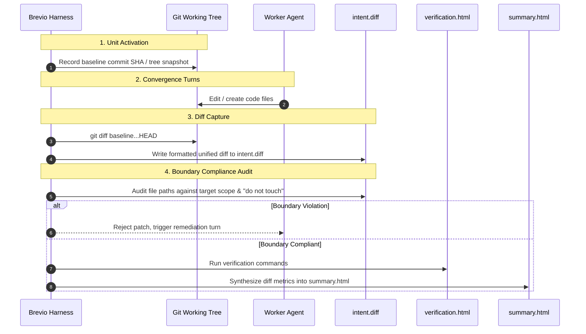
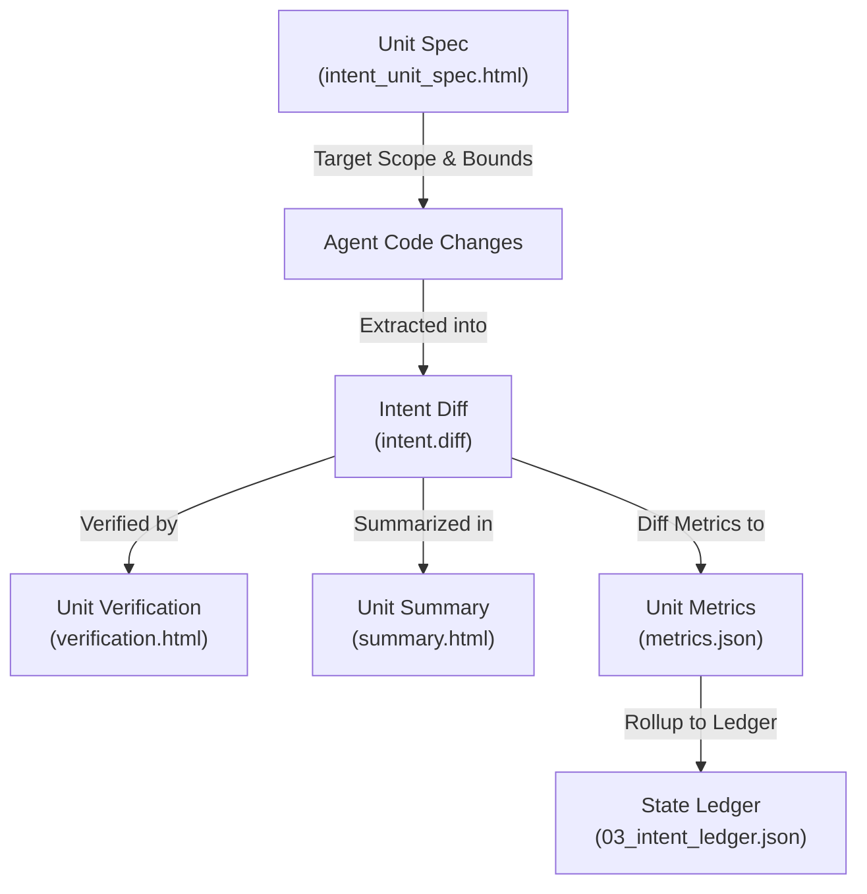

# Intent Diff Document Definition

The Intent Diff Document (`units/{unit_id}/intent.diff`) is the authoritative Tier 3 code patch artifact in the `brevio`
work item lifecycle. It records the deterministic, unified git diff of all source code changes, file creations, and file
deletions that an agent makes during atomic unit execution.

[`intent_unit_spec.html`](intent-unit-specification.md) declares the change instructions before the work starts.
[`summary.html`](unit-summary.md) renders M3 visual cards and summary metrics for people. `intent.diff` is the pure,
portable code patch file (`text/x-diff`, UTF-8). It gives an immutable code diff that machines can apply. It connects
agent code generation directly to version control systems, verification suites, and automated patch review pipelines.

This document has two uses:

1. Harness & Tooling Interface (Deterministic Patch Portability): The file uses the strict POSIX/Git Unified Diff format
   (`diff -u`, `git diff`). Automated harness components can validate patches (`git apply --check`), apply changes, and
   revert changes. They can also do AST-level impact analysis or give context to code-review agents, without parsing
   XHTML.
2. Auditability & Boundary Verification: The file is an immutable artifact. Tools use it to make sure that only the
   `target-files` declared in `intent_unit_spec.html` changed, and that no file in the "do not touch" manifest changed.
   It feeds directly into the `diffChurnRatio` calculations in [`metrics.json`](unit-conversation-metrics.md).

---

## Core Paradigm: Applying the Four Dimensions to Intent Diffs

In `brevio`, unit diffs record and enforce execution compliance against the four basic dimensions:

| Dimension       | Human Engineer Focus                                                                  | AI Coding Tool Focus                                                                              | `brevio` Intent Diff Manifestation                                                                                                                                      |
|:----------------|:--------------------------------------------------------------------------------------|:--------------------------------------------------------------------------------------------------|:--------------------------------------------------------------------------------------------------------------------------------------------------------------------|
| Context         | Uses unwritten codebase conventions and domain knowledge that the team shares.        | Needs explicit file paths, referenced patterns, and strict "do not touch" constraints.            | Formally lists the exact diff hunks applied to the repository. Proves that no protected or "do not touch" file has an unauthorized change.                          |
| Granularity     | Focuses on high-level patterns and architecture. Details wait until implementation.   | Needs atomic sub-units with one responsibility each and deterministic inputs and outputs.         | Keeps code changes strictly inside the bounded responsibility of the atomic unit. The diff hunks are surgical, with no feature bleed across units and no unrelated refactoring. |
| Verification    | Manual PR review, local exploratory debugging, automated CI.                          | Explicit terminal commands after each step (lint, test, build), with deterministic parsing of the output. | Gives a standardized patch file. Before the test execution that `verification.html` records, tools can make sure that the patch applies with a dry run of `git apply --check`. |
| Edge Cases      | Usually found through intuitive testing or code review cycles.                        | Must be listed in full before the work starts, to prevent naive happy-path assumptions.           | Proves that the new code branches, guards, and assertions implement all edge case requirements (`EC-###`) from the specification.                                  |

---

## Table of Contents

1. [File Location & Organization Standard](#1-file-location--organization-standard)
2. [Format Specification & Patch Architecture](#2-format-specification--patch-architecture)
    - 2.1. [Standard Git Unified Diff Format](#21-standard-git-unified-diff-format)
    - 2.2. [Patch Header & Chunk Anatomy](#22-patch-header--chunk-anatomy)
    - 2.3. [File Lifecycle Representations](#23-file-lifecycle-representations)
    - 2.4. [Hunk Context & Precision](#24-hunk-context--precision)
3. [Concrete Patch Example (`intent.diff`)](#3-concrete-patch-example-intentdiff)
4. [Harness Lifecycle & Diff Generation Workflow](#4-harness-lifecycle--diff-generation-workflow)
    - 4.1. [Working Tree Baseline & Snapshotting](#41-working-tree-baseline--snapshotting)
    - 4.2. [Automated Diff Extraction](#42-automated-diff-extraction)
    - 4.3. [Boundary & "Do Not Touch" Compliance Auditing](#43-boundary--do-not-touch-compliance-auditing)
    - 4.4. [Patch Application, Staging, and Reversion](#44-patch-application-staging-and-reversion)
5. [Diff Churn, Surgical Patching & Token Optimization](#5-diff-churn-surgical-patching--token-optimization)
    - 5.1. [Calculating Diff Churn Ratio](#51-calculating-diff-churn-ratio)
    - 5.2. [Downstream Agent Ingestion Patterns](#52-downstream-agent-ingestion-patterns)
6. [Tooling, Analysis Patterns & Terminal Workflows](#6-tooling-analysis-patterns--terminal-workflows)
7. [Lineage, Rollup & Ledger Integration](#7-lineage-rollup--ledger-integration)
8. [Rules & Constraints](#8-rules--constraints)
9. [Revisions](#9-revisions)

---

## 1. File Location & Organization Standard

Each unit diff artifact is directly inside its isolated unit directory. It is next to the specification, validation,
summary, conversation log, and metrics of the unit:

```text
.brevio/
└── work_items/
    └── {intent-id}/
        └── sub_intents/
            └── phase_{NN}_{phase_slug}/
                └── units/
                    └── task_{NNN}_{task_slug}/
                        ├── intent_unit_spec.html          # Goal, Target Scope, Invariants & Verification Contract
                        ├── verification.html         # Test Runs, Exit Codes & Formal Verdict
                        ├── intent.diff               # Authoritative Unit Unified Git Diff
                        ├── summary.html            # File Touchpoints & Git Diff Summary
                        ├── conversation.jsonl      # Authoritative Turn-by-Turn Interaction Log
                        └── metrics.json            # Derived Token, Trajectory & Cost Telemetry
```

- File Name: `intent.diff`
- Format: Unified Diff format (`text/x-diff`, UTF-8, POSIX line endings `\n`).
- Lifecycle Scope: When the unit execution turns complete and code changes exist, the harness generates the file. It stays
  immutable after [`verification.html`](unit-verification.md) passes. It is committed together with
  [`summary.html`](unit-summary.md).
- Paired Artifacts:
    - Instructions: [`intent_unit_spec.html`](intent-unit-specification.md)
    - Verification Evidence: [`verification.html`](unit-verification.md)
    - Commit Summary: [`summary.html`](unit-summary.md)
    - Verbatim Transcript: [`conversation.jsonl`](unit-conversation.md)
    - Aggregated Telemetry: [`metrics.json`](unit-conversation-metrics.md)

---

## 2. Format Specification & Patch Architecture

### 2.1. Standard Git Unified Diff Format

`intent.diff` conforms strictly to the standard Git Unified Diff format that `git diff` or `git diff -U3` generates. It
contains one or more file patches, joined in alphabetical or execution order.

### 2.2. Patch Header & Chunk Anatomy

Each changed file in `intent.diff` has these parts:

1. Git Diff Command Header: `diff --git a/{path} b/{path}`
2. Extended Index Header: `index {old_hash}..{new_hash} {mode}` (or a file mode indicator)
3. File Path Markers:
    - `--- a/{path}` (source version, or `--- /dev/null` for new files)
    - `+++ b/{path}` (target version, or `+++ /dev/null` for deleted files)
4. Hunk Headers: `@@ -{old_start},{old_len} +{new_start},{new_len} @@ {optional_context_heading}`
5. Hunk Lines:
    - ` ` (single space prefix): Unchanged context line
    - `-` (minus prefix): Deleted line
    - `+` (plus prefix): Added line

### 2.3. File Lifecycle Representations

- New File Created:
  ```diff
  diff --git a/src/main/resources/db/migration/V1__init_auth.sql b/src/main/resources/db/migration/V1__init_auth.sql
  new file mode 100644
  index 0000000..7a8b9c0
  --- /dev/null
  +++ b/src/main/resources/db/migration/V1__init_auth.sql
  @@ -0,0 +1,48 @@
  +CREATE TABLE user_accounts (
  ...
  ```
- Existing File Modified:
  ```diff
  diff --git a/src/test/resources/fixtures/auth_seed.sql b/src/test/resources/fixtures/auth_seed.sql
  index 1234567..89abcdef 100644
  --- a/src/test/resources/fixtures/auth_seed.sql
  +++ b/src/test/resources/fixtures/auth_seed.sql
  @@ -15,4 +15,6 @@ INSERT INTO roles (id, name) VALUES (1, 'ROLE_USER');
  +INSERT INTO roles (id, name) VALUES (2, 'ROLE_ADMIN');
  ```
- File Deleted:
  ```diff
  diff --git a/legacy/old_auth.sql b/legacy/old_auth.sql
  deleted file mode 100644
  index 456789a..0000000
  --- a/legacy/old_auth.sql
  +++ /dev/null
  @@ -1,15 +0,0 @@
  -...
  ```

### 2.4. Hunk Context & Precision

- Context Window: By default, 3 lines of context (`-U3`) above and below changes.
- Whitespace Cleanliness: No trailing whitespace and no inconsistent changes to line endings.
- Surgical Bounds: Edits must not touch unaffected methods, reformat unrelated blocks, or remove comments from adjacent
  code.

---

## 3. Concrete Patch Example (`intent.diff`)

This is a complete, realistic example of the `intent.diff` that `unit_001_create_tables` produces:

```diff
diff --git a/src/main/resources/db/migration/V1__init_auth.sql b/src/main/resources/db/migration/V1__init_auth.sql
new file mode 100644
index 0000000..6b453e1
--- /dev/null
+++ b/src/main/resources/db/migration/V1__init_auth.sql
@@ -0,0 +1,28 @@
+-- V1__init_auth.sql: Initialize user accounts and authentication tables
+
+CREATE TABLE user_accounts (
+    id BIGSERIAL PRIMARY KEY,
+    username VARCHAR(64) NOT NULL UNIQUE,
+    email VARCHAR(255) NOT NULL UNIQUE,
+    password_hash VARCHAR(255) NOT NULL,
+    is_active BOOLEAN NOT NULL DEFAULT TRUE,
+    created_at TIMESTAMP WITH TIME ZONE NOT NULL DEFAULT CURRENT_TIMESTAMP,
+    updated_at TIMESTAMP WITH TIME ZONE NOT NULL DEFAULT CURRENT_TIMESTAMP
+);
+
+CREATE TABLE refresh_tokens (
+    id BIGSERIAL PRIMARY KEY,
+    user_id BIGINT NOT NULL REFERENCES user_accounts(id) ON DELETE CASCADE,
+    token VARCHAR(512) NOT NULL UNIQUE,
+    expires_at TIMESTAMP WITH TIME ZONE NOT NULL,
+    revoked BOOLEAN NOT NULL DEFAULT FALSE,
+    created_at TIMESTAMP WITH TIME ZONE NOT NULL DEFAULT CURRENT_TIMESTAMP
+);
+
+CREATE INDEX idx_user_accounts_username ON user_accounts(username);
+CREATE INDEX idx_user_accounts_email ON user_accounts(email);
+CREATE INDEX idx_refresh_tokens_token ON refresh_tokens(token);
+CREATE INDEX idx_refresh_tokens_user_id ON refresh_tokens(user_id);
diff --git a/src/test/resources/fixtures/auth_seed.sql b/src/test/resources/fixtures/auth_seed.sql
index a1b2c3d..e4f5a6b 100644
--- a/src/test/resources/fixtures/auth_seed.sql
+++ b/src/test/resources/fixtures/auth_seed.sql
@@ -10,3 +10,7 @@ INSERT INTO permissions (id, code) VALUES (1, 'READ_PRIVILEGES');
 INSERT INTO permissions (id, code) VALUES (2, 'WRITE_PRIVILEGES');
+
+-- Seed baseline test accounts for validation suite
+INSERT INTO user_accounts (id, username, email, password_hash)
+VALUES (1, 'testuser', 'testuser@example.com', '$argon2id$v=19$m=65536,t=3,p=4$dummy_hash');
```

---

## 4. Harness Lifecycle & Diff Generation Workflow

The `brevio` harness generates `intent.diff` as part of the unit execution lifecycle:



### 4.1. Working Tree Baseline & Snapshotting

Before an agent starts to execute an atomic unit:

1. The harness records the clean git tree state or the baseline commit SHA.
2. The harness indexes all untracked files that existed before unit activation. This keeps environment artifacts
   separate from unit outputs.

### 4.2. Automated Diff Extraction

When the code change turns complete, the harness extracts the working tree changes:

```bash
git diff --no-color -U3 > .brevio/work_items/{work_item_id}/sub_intents/{sub_intent_id}/units/{unit_id}/intent.diff
```

For new untracked files, the harness first stages them as intent-to-add (`git add -N`). Then it generates the diff, so
that new files appear with `new file mode 100644`.

### 4.3. Boundary & "Do Not Touch" Compliance Auditing

After the harness writes `intent.diff`, it parses the file headers (`diff --git a/{path} b/{path}`). It compares them
with `intent_unit_spec.html`:

1. Target Scope Check: Every path in `intent.diff` must match the required `<meta name="target-files">` of
   `intent_unit_spec.html`. A path outside the target scope moves the unit to `drift_detected`.
2. "Do Not Touch" Enforcement: If any hunk touches a protected file or a frozen interface signature, the harness
   immediately flags the unit with a boundary violation (`boundaryViolationsCount > 0`).
3. Convergence Gate: If boundary or scope violations exist, verification fails and the unit enters `drift_detected`. The
   change is not committed. After targeted remediation, the unit returns to `converging`.

### 4.4. Patch Application, Staging, and Reversion

`intent.diff` is a standard unified patch. This makes deterministic changes to the workspace possible:

- Dry-Run Validation:
  ```bash
  git apply --check intent.diff
  ```
- Patch Application in Clean Worktrees:
  ```bash
  git apply --whitespace=nowarn intent.diff
  ```
- Reversion / Rollback on Failed Verification:
  ```bash
  git apply --reverse intent.diff
  ```

---

## 5. Diff Churn, Surgical Patching & Token Optimization

### 5.1. Calculating Diff Churn Ratio

`intent.diff` gives the raw data for the `diffChurnRatio` metric in [`metrics.json`](unit-conversation-metrics.md):

$$\text{Diff Churn Ratio} = \frac{\text{Generated Lines Changed}}{\text{Net Accepted Lines}} = \frac{\text{Lines Added} + \text{Lines Deleted}}{\text{Lines Added} - \text{Lines Deleted}}$$

- Target Range: $1.0$ to $1.25$.
- High Churn Detection ($> 1.5$): Shows that an agent rewrote full files, reformatted unrelated code, deleted existing
  docstrings, or overwrote its own edits many times.

### 5.2. Downstream Agent Ingestion Patterns

Downstream agents read `intent.diff` during post-unit review, verification, or sub-intent summary generation. They do not
load thousands of lines of full source files into the LLM context:

- Context Reduction: `intent.diff` uses 80%–95% fewer tokens in an LLM than the full modified source files.
- Focused Code Review: Reviewer models inspect only the added (`+`) and removed (`-`) lines, with bounded context.

---

## 6. Tooling, Analysis Patterns & Terminal Workflows

These are common terminal commands and analysis patterns for `intent.diff`:

### 6.1. Inspecting Diff Line Statistics

```bash
# Generate file touchpoint statistics from intent.diff
diffstat -p1 intent.diff
```

### 6.2. Verifying Patch Cleanliness

```bash
# Ensure patch applies cleanly with zero offset errors or whitespace warnings
git apply --check --whitespace=error intent.diff
```

### 6.3. Extracting Modified File List from Patch

```bash
# Extract relative file paths touched by intent.diff
awk '/^diff --git/ {print $3}' intent.diff | sed 's|^a/||'
```

### 6.4. Filtering Changes to a Specific Subsystem

```bash
# Extract diff hunks targeting SQL migration files only
filterdiff -p1 -I 'src/main/resources/db/**' intent.diff
```

---

## 7. Lineage, Rollup & Ledger Integration

`intent.diff` is part of the two-way traceability graph of the work item:



- Ledger Pointer: `03_intent_ledger.json` registers the file under `sub-intents[].units[].paths.diff`
  (`sub_intents/{sub-intent}/units/{unit}/intent.diff`).
- Summary Citation: `summary.html` links to the file directly with `<meta name="diff-ref" content="intent.diff"/>` and
  renders it in the diff metrics section.
- Conversation Session Context: `conversation.jsonl` refers to the file under `paths.diff`.

---

## 8. Rules & Constraints

1. Strict Unified Diff Compliance: `intent.diff` must be a valid, standard unified diff that standard POSIX `patch` and
   `git apply` can parse.
2. UTF-8 with Unix Line Endings: The patch must use UTF-8 encoding and `\n` (LF) line terminators.
3. Strict Boundary Adherence: The patch must touch only the files that `target-files` in `intent_unit_spec.html`
   declares. No change to a "do not touch" path is permitted.
4. Immutability Post-Validation: After `verification.html` records `validation-verdict="pass"` and the unit is marked
   `completed`, `intent.diff` is sealed. It must not be overwritten or changed.
5. Zero Secret Leakage: Before `intent.diff` is written to disk, harness sanitizers must make sure that sensitive
   credentials, API keys, and environment tokens are removed.

---

## 9. Revisions

| Date       | Version | Description                                                                                                                                                                     | Source                |
|:-----------|:--------|:--------------------------------------------------------------------------------------------------------------------------------------------------------------------------------|:----------------------|
| 2026-11-25 | 1.1.1   | Rewrote the prose in plain English. No change to the design. | User request |
| 2026-10-31 | 1.1.0 | Moved to the intent-based document set: intent, sub-intent, and unit terminology, convergence states, required target scope, and evidence requirement IDs. | TOPIC-005 |
| 2026-09-06 | 1.0.0   | Authoritative specification for Intent Diff (`units/{unit_id}/intent.diff`) establishing unified diff standards, lifecycle generation, boundary compliance, and diff churn metrics. | Feature Specification |
