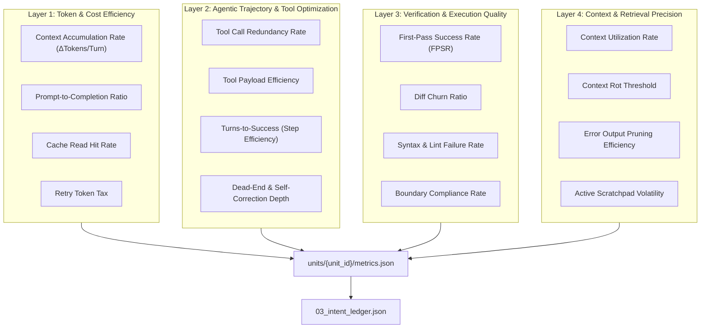
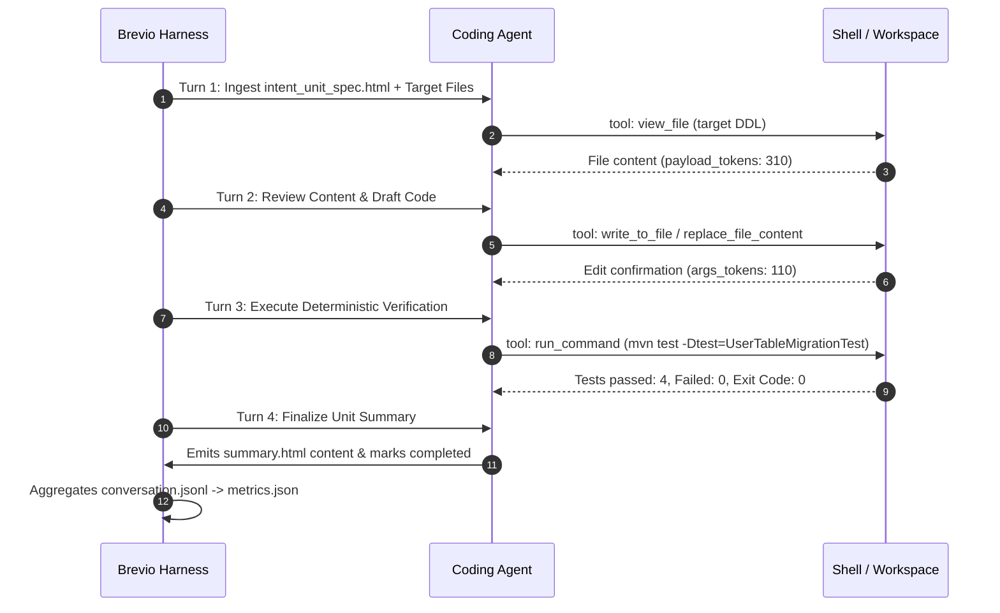
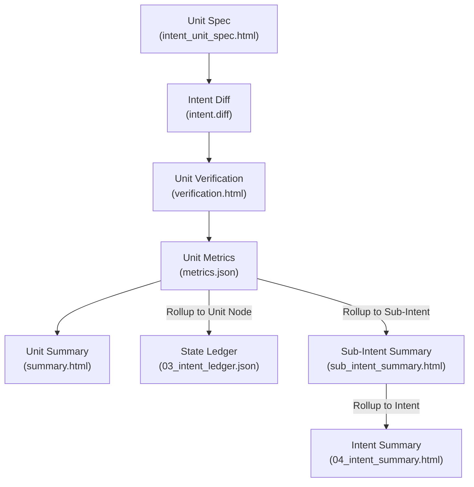

# Unit Conversation Metrics Document Definition

The Unit Conversation Metrics Document (`units/{unit_id}/metrics.json`) is the authoritative Tier 3 telemetry record
for one atomic engineering unit. It is part of the work item lifecycle of `brevio` (Token Optimized Software Harness).
It records the exact token use, model use, prompt caching efficiency, tool execution trajectories, diff churn, and
verification outcomes of the unit.

In `brevio`, you cannot evaluate token optimization in isolation. Some token savings come from withholding file
context, removing type definitions, or cutting compiler errors too short. These savings often cause multi-turn repair
loops, early failure, and bloated diff churn. The result is an exponential increase in total compute.

This document has two uses:

1. Human & Platform Interface: Platform engineers, engineering managers, and developers use the document to audit token
   costs at the unit level and to diagnose runaway agent repair loops. They also compare the cost-to-performance ratios
   of models and inspect how surgical the diffs are.
2. Agent / Harness Interface: The document is a deterministic JSON artifact for machines. The `brevio` CLI and
   evaluators query it for automated unit gating, ledger state synchronization, and dynamic tuning of the prompt cache.

---

## Core Execution Paradigm: The 4-Layer Unit Telemetry Framework

`brevio` organizes unit-level telemetry in four operational layers. These layers give signals from raw unit session
logs (`conversation.jsonl`) that teams can act on:



---

## Table of Contents

1. [File Location & Organization Standard](#1-file-location--organization-standard)
2. [The 4-Layer Unit Telemetry Framework](#2-the-4-layer-unit-telemetry-framework)
    - 2.1. [Layer 1: Token & Cost Efficiency Metrics](#21-layer-1-token--cost-efficiency-metrics)
    - 2.2. [Layer 2: Agentic Trajectory & Tool Optimization](#22-layer-2-agentic-trajectory--tool-optimization)
    - 2.3. [Layer 3: Verification & Execution Quality](#23-layer-3-verification--execution-quality)
    - 2.4. [Layer 4: Context & Retrieval Precision](#24-layer-4-context--retrieval-precision)
3. [JSON Schema Specification (`units/{unit_id}/metrics.json`)](#3-json-schema-specification-unitsunit_idmetricsjson)
4. [Turn-Level Session Log Schema (`conversation.jsonl`)](#4-turn-level-session-log-schema-conversationjsonl)
5. [Token Optimization, Analysis Patterns & CLI / jq Queries](#5-token-optimization-analysis-patterns--cli--jq-queries)
6. [Lineage, Rollup & Ledger Integration](#6-lineage-rollup--ledger-integration)
7. [Rules & Constraints](#7-rules--constraints)
8. [Revisions](#8-revisions)

---

## 1. File Location & Organization Standard

Each unit conversation metrics document is directly inside its isolated unit directory, in its parent sub-intent:

```text
.brevio/
└── work_items/
    └── {intent-id}/
        └── sub_intents/
            └── phase_{NN}_{phase_slug}/
                └── units/
                    └── task_{NNN}_{task_slug}/
                        ├── intent_unit_spec.html          # Scope, Target Files & Acceptance Criteria
                        ├── verification.html         # Test Runs, Exit Codes & Verdict
                        ├── intent.diff               # Unit File Diff
                        ├── summary.html            # File Touchpoints & Git Diff Summary
                        ├── conversation.jsonl      # Turn-by-Turn Session Log
                        └── metrics.json            # Authoritative Unit Conversation Metrics
```

- File Name: `metrics.json`
- Format: Strict JSON (UTF-8, 2-space indentation).
- Paired Log: [`conversation.jsonl`](unit-conversation.md) records the session turns.
- Paired Documents:
    - Instructions: [`intent_unit_spec.html`](intent-unit-specification.md)
    - Verification: [`verification.html`](unit-verification.md)
    - Diff: [intent.diff](intent-diff.md)
    - Outcome: [`summary.html`](unit-summary.md)

---

## 2. The 4-Layer Unit Telemetry Framework

### 2.1. Layer 1: Token & Cost Efficiency Metrics

These metrics track the token burn rate, the prompt caching performance, and the economic efficiency of the code
implementation.

| Metric Name                                 | Formula / Measurement                                                                                   | Target Range                         | Purpose & Harness Improvement Area                                                                                                                                                                      |
|:--------------------------------------------|:--------------------------------------------------------------------------------------------------------|:-------------------------------------|:--------------------------------------------------------------------------------------------------------------------------------------------------------------------------------------------------------|
| Context Accumulation Rate                   | $\Delta\text{Tokens} / \text{Turn} = \frac{\text{Prompt Tokens}_{N} - \text{Prompt Tokens}_{1}}{N - 1}$ | Linear slope ($< 1,200$ tokens/turn) | Measures how much input tokens grow for each repair turn. Steep quadratic growth shows that the harness dumps full build logs or raw file dumps into prompts, not surgical diffs. |
| Prompt-to-Completion Ratio                  | $\frac{\text{Prompt Tokens}}{\text{Completion Tokens}}$                                                 | $80:20$ to $92:8$                    | Coding agents are input-heavy by nature. If the ratio exceeds $98:2$, the system prompts are bloated, or the model makes very small edits across too many round trips.                                 |
| Token Cost per Resolved Unit                | Total unit tokens consumed                                                                              | $< 15,000$ tokens/unit               | The main benchmark for prompt compression, tool schema ergonomics, and harness efficiency.                                                                                                              |
| Cache Read Hit Rate                         | $\frac{\text{Cache Read Tokens}}{\text{Total Prompt Tokens}} \times 100\%$                              | $> 75\%$                             | Percentage of input tokens that prefix caching serves during multi-turn test/repair cycles. Shows whether the prefix order (system prompt $\to$ tools $\to$ static specs $\to$ history) stays intact. |
| Retry Token Tax *(Suggested)*               | $\frac{\text{Tokens Consumed in Repair Turns}}{\text{Total Unit Tokens}} \times 100\%$                  | $\le 20\%$                           | Measures the token cost after the first test failure. High values show unstable first implementations or poor compiler error diagnostics.                                                              |
| Cost per Net Accepted LOC *(Suggested)*     | $\frac{\text{Total Cost (USD)}}{\text{Net Accepted Lines of Code}}$                                     | $<\$0.005$ / line                    | Evaluates the direct cost for each accepted line of production code.                                                                                                                                   |

---

### 2.2. Layer 2: Agentic Trajectory & Tool Optimization

Waste in agent execution shows as redundant tool executions, dead-end repair cycles, and oversized tool payloads.

| Metric Name                                      | Formula / Measurement                                                                  | Target Range                                              | Purpose & Harness Improvement Area                                                                                                                                                                        |
|:-------------------------------------------------|:---------------------------------------------------------------------------------------|:----------------------------------------------------------|:----------------------------------------------------------------------------------------------------------------------------------------------------------------------------------------------------------|
| Tool Call Redundancy Rate                        | $\frac{\text{Duplicate Tool Invocations}}{\text{Total Tool Invocations}}$              | $\le 5\%$                                                 | How often an agent calls the same tool with identical arguments (for example, it reads the same unmodified file twice, or runs `git status` again and again). In-memory caching of tool results corrects this. |
| Tool Payload Efficiency                          | $\frac{\text{Tokens Referenced in Subsequent Action}}{\text{Tokens Returned by Tool}}$ | $\ge 40\%$                                                | Ratio of the tokens that tools return (for example, terminal test output, file contents) to the tokens that the agent actually acts on. This metric needs output truncation, targeted AST viewers, and line-bounded reads. |
| Turns-to-Success (Step Efficiency)               | Total LLM round trips to complete the unit                                             | $\le 5$ turns                                             | Round trips needed from loading the unit specification until `verification.html` passes. Detects agent hesitation or underspecified unit instructions.                                                   |
| Dead-End & Self-Correction Depth                 | Consecutive turns spent to recover from errors                                         | $\le 2$ turns                                             | Turns spent in unbroken failure loops (compiler errors, failing tests, invalid tool calls). A high depth shows code drift that the agent cannot recover from. That drift needs an early circuit break. |
| Terminal Command Success Ratio *(Suggested)*     | $\frac{\text{Commands with Exit Code 0}}{\text{Total Commands Executed}}$              | $\ge 70\%$                                                | Measures how precise terminal commands are. A very low ratio shows guesswork in build or test commands.                                                                                                   |
| Tool Action Distribution *(Suggested)*           | Turn breakdown: Read vs Edit vs Exec vs Thinking                                       | Balanced (for example, 20% Read, 30% Edit, 30% Test, 20% Verify) | Detects unbalanced agent behavior (for example, 80% of turns spent reading, with no edits).                                                                                                        |

---

### 2.3. Layer 3: Verification & Execution Quality

Token savings have no value if the generated code does not compile, breaks regression tests, or generates sprawling
churn.

| Metric Name                                 | Formula / Measurement                                                          | Target Range    | Purpose & Harness Improvement Area                                                                                                                                               |
|:--------------------------------------------|:-------------------------------------------------------------------------------|:----------------|:---------------------------------------------------------------------------------------------------------------------------------------------------------------------------------|
| First-Pass Success Rate (FPSR)              | Lint, build, and tests pass on attempt 1                                       | $1.0$ ($100\%$) | Percentage of units that succeed on the first execution attempt, with no self-correction repair loop.                                                                            |
| Diff Churn Ratio                            | $\frac{\text{Generated Lines Changed}}{\text{Net Accepted Lines}}$             | $1.0 - 1.25$    | Tells full-file rewrites apart from surgical unified diffs. A ratio $> 2.0$ shows sloppy refactors, deleted comments, or unnecessary whitespace reformatting.                    |
| Syntax & Lint Failure Rate                  | $\frac{\text{Syntax/Lint Errors}}{\text{Total Verification Attempts}}$         | $0\%$           | How often edits fail because of parse errors, missing imports, invalid regex, or linter complaints. High rates justify pre-LLM linting or AST patch validators in the harness.   |
| Boundary Violation Rate *(Suggested)*       | $\frac{\text{Edits Attempted on Protected Files}}{\text{Total Edit Attempts}}$ | $0\%$ ($0.0$)   | Measures strict compliance with the "do not touch" manifests in `intent_unit_spec.html`. Any non-zero value shows that the prompt boundary leaks.                                |
| Regression Induction Rate *(Suggested)*     | Existing passing tests that the unit breaks                                    | $0$             | Measures code safety. High regression counts point to inadequate pre-context or missing integration test checks.                                                                |

---

### 2.4. Layer 4: Context & Retrieval Precision

Coding agents must work with context that has a narrow, exact scope. If an agent ingests whole repositories, its
reasoning gets worse and it wastes tokens.

| Metric Name                                       | Formula / Measurement                                                                      | Target Range            | Purpose & Harness Improvement Area                                                                                                    |
|:--------------------------------------------------|:-------------------------------------------------------------------------------------------|:------------------------|:--------------------------------------------------------------------------------------------------------------------------------------|
| Context Utilization Rate                          | $\frac{\text{Injected Snippets Referenced/Modified}}{\text{Total Injected File Snippets}}$ | $\ge 75\%$              | Percentage of retrieved workspace context files or interfaces that the final patch actually references, imports, or modifies.         |
| Context Rot Threshold                             | Token depth at which recall becomes worse                                                  | $> 85\%$ of window      | The point during multi-turn debugging at which the agent forgets earlier instructions, drops edge cases, or violates "do not touch" constraints. |
| Error Output Pruning Efficiency *(Suggested)*     | $\frac{\text{Sanitized Error Hunk Tokens}}{\text{Raw Terminal stderr Tokens}}$             | $\le 20\%$ (80% pruned) | Measures how well the harness reduces verbose stack traces, dependency notices, and ANSI codes to the failure lines that matter.      |
| Active Scratchpad Volatility *(Suggested)*        | $\Delta\text{Scratchpad Tokens} / \text{Turn}$                                             | Stable ($\pm 15\%$)     | Tracks whether unit memory stays focused or collects obsolete debug notes.                                                            |

---

## 3. JSON Schema Specification (`units/{unit_id}/metrics.json`)

This JSON Schema defines the structure and validation of `units/{unit_id}/metrics.json`:

```json
{
  "$schema": "https://json-schema.org/draft/2020-12/schema",
  "$id": "https://brevio.dev/schemas/work-items/unit-conversation-metrics.schema.json",
  "title": "TaskConversationMetrics",
  "description": "Authoritative Tier 3 unit execution metrics and telemetry record.",
  "type": "object",
  "required": [
    "docId",
    "docType",
    "schemaVersion",
    "workItemId",
    "subIntentId",
    "unitId",
    "status",
    "timestamps",
    "tokenEfficiency",
    "agenticTrajectory",
    "executionQuality",
    "contextEngineering",
    "diffMetrics",
    "costRollup"
  ],
  "properties": {
    "docId": {
      "type": "string",
      "pattern": "^WI-[0-9]{8}T[0-9]{6}Z:P[0-9]{2}:T[0-9]{3}:METRICS$"
    },
    "docType": {
      "type": "string",
      "const": "unit-conversation-metrics"
    },
    "schemaVersion": {
      "type": "string",
      "const": "1.0.0"
    },
    "workItemId": {
      "type": "string",
      "pattern": "^[0-9]{8}T[0-9]{6}Z_[a-z0-9_]+$"
    },
    "subIntentId": {
      "type": "string",
      "pattern": "^phase_[0-9]{2}_[a-z0-9_]+$"
    },
    "unitId": {
      "type": "string",
      "pattern": "^task_[0-9]{3}_[a-z0-9_]+$"
    },
    "status": {
      "type": "string",
      "enum": [
        "pending",
        "in-progress",
        "completed",
        "failed"
      ]
    },
    "timestamps": {
      "type": "object",
      "required": [
        "startedAt",
        "completedAt",
        "executionDurationMs"
      ],
      "properties": {
        "startedAt": {
          "type": "string",
          "format": "date-time"
        },
        "completedAt": {
          "type": "string",
          "format": "date-time"
        },
        "executionDurationMs": {
          "type": "integer",
          "minimum": 0
        }
      }
    },
    "tokenEfficiency": {
      "type": "object",
      "required": [
        "totalTokens",
        "promptTokens",
        "completionTokens",
        "cacheReadTokens",
        "cacheCreationTokens",
        "cacheReadHitRatePct",
        "promptToCompletionRatio",
        "contextAccumulationRateDeltaPerTurn",
        "retryTokenTaxPct"
      ],
      "properties": {
        "totalTokens": {
          "type": "integer",
          "minimum": 0
        },
        "promptTokens": {
          "type": "integer",
          "minimum": 0
        },
        "completionTokens": {
          "type": "integer",
          "minimum": 0
        },
        "cacheReadTokens": {
          "type": "integer",
          "minimum": 0
        },
        "cacheCreationTokens": {
          "type": "integer",
          "minimum": 0
        },
        "cacheReadHitRatePct": {
          "type": "number",
          "minimum": 0,
          "maximum": 100
        },
        "promptToCompletionRatio": {
          "type": "string"
        },
        "contextAccumulationRateDeltaPerTurn": {
          "type": "number"
        },
        "retryTokenTaxPct": {
          "type": "number",
          "minimum": 0,
          "maximum": 100
        },
        "costPerNetAcceptedLoc": {
          "type": "number",
          "minimum": 0
        }
      }
    },
    "agenticTrajectory": {
      "type": "object",
      "required": [
        "turnsToSuccess",
        "totalToolCalls",
        "toolCallRedundancyRatePct",
        "toolPayloadEfficiencyPct",
        "deadEndTurnsCount",
        "terminalCommandSuccessRatioPct"
      ],
      "properties": {
        "turnsToSuccess": {
          "type": "integer",
          "minimum": 1
        },
        "totalToolCalls": {
          "type": "integer",
          "minimum": 0
        },
        "toolCallRedundancyRatePct": {
          "type": "number",
          "minimum": 0,
          "maximum": 100
        },
        "toolPayloadEfficiencyPct": {
          "type": "number",
          "minimum": 0,
          "maximum": 100
        },
        "deadEndTurnsCount": {
          "type": "integer",
          "minimum": 0
        },
        "terminalCommandSuccessRatioPct": {
          "type": "number",
          "minimum": 0,
          "maximum": 100
        }
      }
    },
    "executionQuality": {
      "type": "object",
      "required": [
        "firstPassSuccess",
        "diffChurnRatio",
        "syntaxLintFailureRatePct",
        "testAssertionsPassed",
        "testAssertionsFailed",
        "boundaryViolationsCount"
      ],
      "properties": {
        "firstPassSuccess": {
          "type": "boolean"
        },
        "diffChurnRatio": {
          "type": "number",
          "minimum": 1.0
        },
        "syntaxLintFailureRatePct": {
          "type": "number",
          "minimum": 0,
          "maximum": 100
        },
        "testAssertionsPassed": {
          "type": "integer",
          "minimum": 0
        },
        "testAssertionsFailed": {
          "type": "integer",
          "minimum": 0
        },
        "boundaryViolationsCount": {
          "type": "integer",
          "minimum": 0
        }
      }
    },
    "contextEngineering": {
      "type": "object",
      "required": [
        "contextUtilizationRatePct",
        "injectedFilesCount",
        "modifiedFilesCount",
        "errorOutputPruningEfficiencyPct",
        "contextRotDetected"
      ],
      "properties": {
        "contextUtilizationRatePct": {
          "type": "number",
          "minimum": 0,
          "maximum": 100
        },
        "injectedFilesCount": {
          "type": "integer",
          "minimum": 0
        },
        "modifiedFilesCount": {
          "type": "integer",
          "minimum": 0
        },
        "errorOutputPruningEfficiencyPct": {
          "type": "number",
          "minimum": 0,
          "maximum": 100
        },
        "contextRotDetected": {
          "type": "boolean"
        }
      }
    },
    "diffMetrics": {
      "type": "object",
      "required": [
        "linesAdded",
        "linesDeleted",
        "netAcceptedLines",
        "generatedLinesChanged"
      ],
      "properties": {
        "linesAdded": {
          "type": "integer",
          "minimum": 0
        },
        "linesDeleted": {
          "type": "integer",
          "minimum": 0
        },
        "netAcceptedLines": {
          "type": "integer",
          "minimum": 0
        },
        "generatedLinesChanged": {
          "type": "integer",
          "minimum": 0
        }
      }
    },
    "costRollup": {
      "type": "object",
      "required": [
        "totalCostUsd",
        "model",
        "currency"
      ],
      "properties": {
        "totalCostUsd": {
          "type": "number",
          "minimum": 0
        },
        "model": {
          "type": "string"
        },
        "currency": {
          "type": "string",
          "const": "USD"
        }
      }
    }
  },
  "additionalProperties": false
}
```

### 3.1. Concrete Instance Example (`units/{unit_id}/metrics.json`)

```json
{
  "docId": "WI-20260830T170936Z:S01:U001:METRICS",
  "docType": "unit-conversation-metrics",
  "schemaVersion": "1.0.0",
  "workItemId": "20260830T170936Z_user_auth_service",
  "subIntentId": "sub_intent_01_database_migration",
  "unitId": "unit_001_create_tables",
  "status": "completed",
  "timestamps": {
    "startedAt": "2026-08-30T17:10:00Z",
    "completedAt": "2026-08-30T17:14:22Z",
    "executionDurationMs": 262000
  },
  "tokenEfficiency": {
    "totalTokens": 12400,
    "promptTokens": 8900,
    "completionTokens": 3500,
    "cacheReadTokens": 6800,
    "cacheCreationTokens": 1200,
    "cacheReadHitRatePct": 76.40,
    "promptToCompletionRatio": "72:28",
    "contextAccumulationRateDeltaPerTurn": 780.0,
    "retryTokenTaxPct": 0.0,
    "costPerNetAcceptedLoc": 0.00044
  },
  "agenticTrajectory": {
    "turnsToSuccess": 4,
    "totalToolCalls": 6,
    "toolCallRedundancyRatePct": 0.0,
    "toolPayloadEfficiencyPct": 62.5,
    "deadEndTurnsCount": 0,
    "terminalCommandSuccessRatioPct": 100.0
  },
  "executionQuality": {
    "firstPassSuccess": true,
    "diffChurnRatio": 1.05,
    "syntaxLintFailureRatePct": 0.0,
    "testAssertionsPassed": 8,
    "testAssertionsFailed": 0,
    "boundaryViolationsCount": 0
  },
  "contextEngineering": {
    "contextUtilizationRatePct": 85.0,
    "injectedFilesCount": 2,
    "modifiedFilesCount": 2,
    "errorOutputPruningEfficiencyPct": 18.2,
    "contextRotDetected": false
  },
  "diffMetrics": {
    "linesAdded": 84,
    "linesDeleted": 0,
    "netAcceptedLines": 84,
    "generatedLinesChanged": 88
  },
  "costRollup": {
    "totalCostUsd": 0.0372,
    "model": "claude-3-5-sonnet",
    "currency": "USD"
  }
}
```

---

## 4. Turn-Level Session Log Schema (`conversation.jsonl`)

Every LLM exchange during unit execution writes an immutable telemetry record into `conversation.jsonl`:

```json
{
  "session_id": "sess-wi-20260830T170936Z-p01-t001",
  "turn_index": 3,
  "role": "assistant",
  "model": "claude-3-5-sonnet",
  "timestamp": "2026-08-30T17:12:15Z",
  "usage": {
    "prompt_tokens": 14250,
    "completion_tokens": 320,
    "cache_read_tokens": 10500,
    "cache_creation_tokens": 0
  },
  "tool_calls": [
    {
      "name": "replace_file_content",
      "args_tokens": 110,
      "response_tokens": 45,
      "status": "success",
      "is_retry": false,
      "tokens_referenced_in_turn": 45
    }
  ],
  "verification": {
    "compiled": true,
    "tests_passed": 4,
    "tests_failed": 0,
    "lint_errors": 0
  },
  "context_stats": {
    "injected_files_count": 3,
    "active_scratchpad_tokens": 480
  }
}
```

### 4.1. Lifecycle Turn Flow Example

A typical passing atomic unit generates a short, deterministic sequence of entries:



---

## 5. Token Optimization, Analysis Patterns & CLI / jq Queries

Filter `.jsonl` and `.json` logs to find runaway sessions, breaks in the prefix cache, and surgical diff failures:

### 5.1. Finding High-Cost / High-Step Outliers (Edge Cases)

```bash
# Surface units with high token consumption or runaway steps
find .brevio/work_items -name "metrics.json" -exec jq -r '
  select(.tokenEfficiency.totalTokens > 30000 or .agenticTrajectory.turnsToSuccess > 8)
  | "\(.unitId): \(.tokenEfficiency.totalTokens) tokens, \(.agenticTrajectory.turnsToSuccess) turns, $\(.costRollup.totalCostUsd)"
' {} +
```

### 5.2. Detecting Bloated File Rewrites (High Diff Churn)

```bash
# Flag units generating full-file rewrites rather than surgical diffs
jq -e '
  select(.executionQuality.diffChurnRatio > 1.5)
  | {unit: .unitId, churn: .executionQuality.diffChurnRatio, gen: .diffMetrics.generatedLinesChanged, net: .diffMetrics.netAcceptedLines}
' metrics.json
```

### 5.3. Inspecting Dead-End Self-Correction Depth

```bash
# Query turns where consecutive tool calls or verifications failed
jq -s '
  map(select(.verification.tests_failed > 0 or .tool_calls[0].status == "error"))
  | length
' conversation.jsonl
```

### 5.4. Auditing Prefix Cache Read Hit Rate Across Turns

```bash
# Monitor cache read percentage across each turn
jq -r '
  "Turn \(.turn_index): CacheHitRate = \((.usage.cache_read_tokens / .usage.prompt_tokens) * 100 | round)%"
' conversation.jsonl
```

---

## 6. Lineage, Rollup & Ledger Integration

The unit metrics file is the atomic sensor that feeds telemetry up into the sub-intent and work item layers:



- Direct Ledger Sync: When a unit completes, `brevio` writes the execution duration, token count, and USD cost of the
  unit directly into `sub-intents[].units[].metrics` of [`03_intent_ledger.json`](intent-ledger.md).
- Sub-Intent Milestone Rollup: [`sub_intent_summary.html`](sub-intent-summary.md) collects all unit `metrics.json`
  records. It reports the total sub-intent tokens, cache hit rates, and total cost.
- Root Rollup: [`04_intent_summary.html`](intent-summary.md) computes the global project metrics rollup across all
  sub-intents.

---

## 7. Rules & Constraints

1. Deterministic Verification: Every completed unit must record passing test assertions (`testAssertionsPassed > 0`,
   `testAssertionsFailed == 0`) from [`verification.html`](unit-verification.md).
2. Zero Boundary Violations: `boundaryViolationsCount` must be exactly `0`. Any write to a file outside `targetScope`,
   or to a file in the "do not touch" list, stops the promotion of the unit.
3. Atomic Generation: When the unit completes, the harness generates `metrics.json` deterministically from
   `conversation.jsonl`. The file must never be written or changed by hand.
4. Stable Prefix Ordering: The harness must assemble prompts in this strict order: System Instructions $\to$ Tool
   Definitions $\to$ Static Unit Spec $\to$ Ephemeral Conversation History. This order keeps `cacheReadHitRatePct`
   high.
5. Circuit Breaker on Dead-Ends: If an agent reaches `deadEndTurnsCount >= 4` without passing verification, the
   harness must stop execution and trigger human intervention. It must not burn unbounded tokens.

---

## 8. Revisions

| Date       | Version | Description                                                                                                                                                                                           | Source                 |
|:-----------|:--------|:------------------------------------------------------------------------------------------------------------------------------------------------------------------------------------------------------|:-----------------------|
| 2026-11-25 | 1.2.1   | Rewrote the prose in plain English. No change to the design. | User request |
| 2026-10-31 | 1.2.0 | Moved to the intent-based document set: intent, sub-intent, and unit terminology, convergence states, required target scope, and evidence requirement IDs. | TOPIC-005 |
| 2026-09-06 | 1.1.0   | Added `intent.diff` to unit directory layout, paired documents list, and traceability graph.                                                                                                            | Feature Specification  |
| 2026-09-06 | 1.0.0   | Authoritative specification for Unit Conversation Metrics (`units/{unit_id}/metrics.json`) establishing the 4-layer telemetry framework, JSON schema, session log contract, and jq analysis patterns. | Feature Specification  |
| 2026-08-30 | 0.1.0   | Initial baseline stub in metadata definition.                                                                                                                                                         | Architecture Alignment |