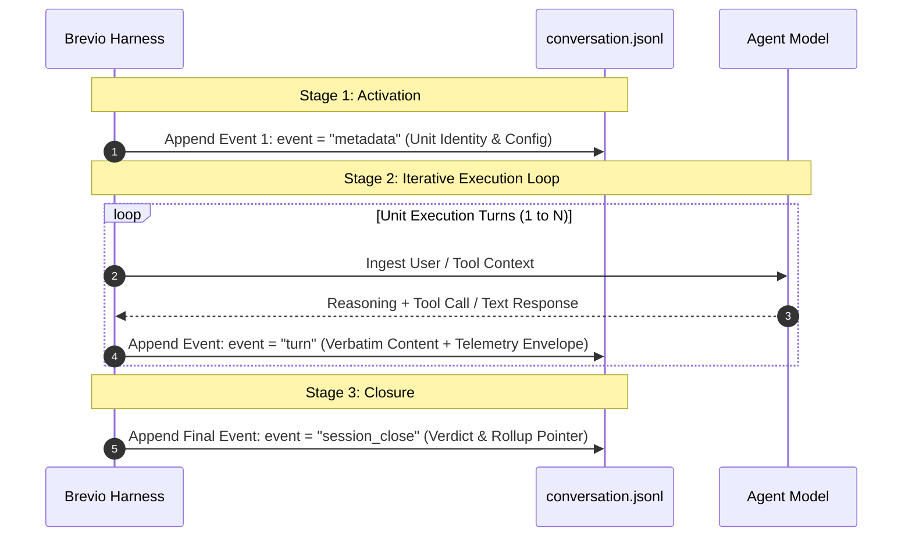
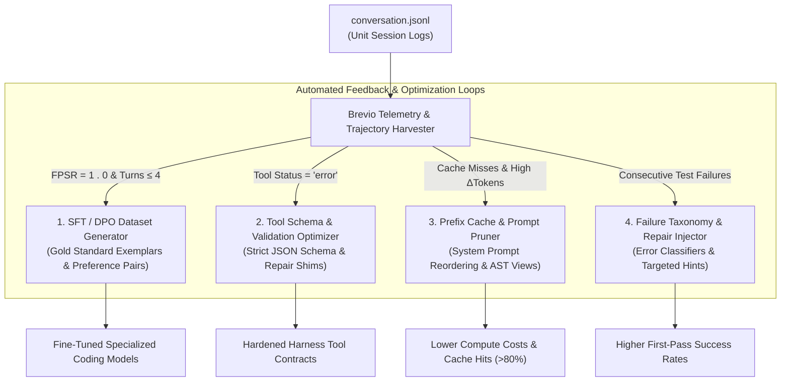
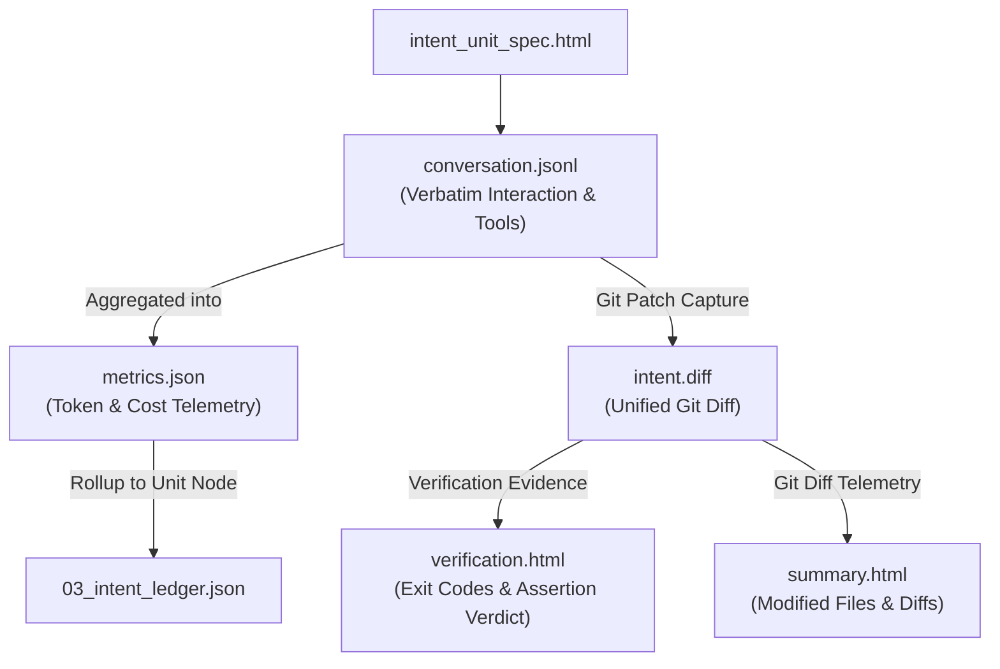

# Unit Conversation Log Document Definition

The Unit Conversation Log Document (`units/{unit_id}/conversation.jsonl`) is the authoritative Tier 3 interaction
record for one unit. It is part of the work item lifecycle of `brevio` (Token Optimized Software Harness). It is an immutable, append-only log of
each turn, from atomic unit activation to unit closure. It covers the full agent LLM dialogue, system prompts, reasoning
traces, tool executions, terminal command streams, and verification feedback.

In `brevio`, unit conversation logs are more than debugging dumps. They are the telemetry data lake that drives
systemic feedback loops. These loops include:

- Offline Model Fine-Tuning & Distillation (SFT/DPO): The logs supply successful execution trajectories for
  high-performance coding models.
- Harness Tool Ergonomics Optimization: The logs show confusing tool argument schemas, bash invocations that fail often,
  and error outputs that give no useful information.
- Prompt Engineering & Context Pruning: Teams test context compression algorithms against replays of past sessions. The
  goal is to maximize prompt-cache hit rates without making the code less correct.

This document has two uses:

1. Human & Platform Interface: Developers and platform teams use the log to inspect the full dialogue word for word and
   to audit how the agent made decisions. They also evaluate chain-of-thought reasoning and investigate execution
   anomalies, in a standardized format that can be streamed.
2. Agent / Harness Interface: The log is the event stream that machines parse. From it, the harness deterministically
   derives [`metrics.json`](unit-conversation-metrics.md), makes sure that the unit complies with its boundaries, and
   feeds downstream dataset generators.

---

## Core Execution Paradigm: Applying the 4 Dimensions to Unit Conversations

In `brevio`, the unit conversation log mechanically records the interaction of the agent across the four core
dimensions:

| Dimension       | Human Engineer Focus                                                                  | AI Coding Tool Focus                                                                              | `brevio` Unit Conversation Log Manifestation                                                                                                    |
|:----------------|:--------------------------------------------------------------------------------------|:--------------------------------------------------------------------------------------------------|:----------------------------------------------------------------------------------------------------------------------------------------------|
| Context         | Uses unwritten codebase conventions and domain knowledge that the team shares.        | Needs explicit file paths, referenced patterns, and strict "do not touch" constraints.            | Logs the exact system prompt states, injected file contents, and scratchpad memory for every turn. Tracks context drift and cache invalidation. |
| Granularity     | Focuses on high-level patterns and architecture. Details wait until implementation.   | Needs atomic sub-units with one responsibility each and deterministic inputs and outputs.         | Keeps conversation turns strictly inside the bounded lifecycle of one unit. This removes multi-unit chatter and context dilution.             |
| Verification    | Manual PR review, local exploratory debugging, automated CI.                          | Explicit terminal commands after each step (lint, test, build), with deterministic parsing of the output. | Records the exact terminal tool inputs, stdout, stderr, process return codes, and test assertions that caused the agent to adjust code. |
| Edge Cases      | Usually found through intuitive testing or code review cycles.                        | Must be listed in full before the work starts, to prevent naive happy-path assumptions.           | Records the exact dialogue steps where the agent met, reasoned through, and satisfied the listed edge cases of the unit (`EC-###`).          |

---

## Table of Contents

1. [File Location & Organization Standard](#1-file-location--organization-standard)
2. [Event Stream Architecture & Hybrid Schema Standard](#2-event-stream-architecture--hybrid-schema-standard)
    - 2.1. [Session Metadata Header Event (`event: metadata`)](#21-session-metadata-header-event-event-metadata)
    - 2.2. [Turn Interaction Event (`event: turn`)](#22-turn-interaction-event-event-turn)
    - 2.3. [Session Closure Event (`event: session_close`)](#23-session-closure-event-event-session_close)
3. [Complete Multi-Turn JSONL Walkthrough Example](#3-complete-multi-turn-jsonl-walkthrough-example)
4. [Downstream Feedback Loop Engine & Optimization Use Cases](#4-downstream-feedback-loop-engine--optimization-use-cases)
    -
    4.1. [Supervised Fine-Tuning (SFT) & Direct Preference Optimization (DPO)](#41-supervised-fine-tuning-sft--direct-preference-optimization-dpo)
    - 4.2. [Tool Schema & Ergonomics Refinement](#42-tool-schema--ergonomics-refinement)
    - 4.3. [Deterministic Context Pruning & Prompt Cache Tuning](#43-deterministic-context-pruning--prompt-cache-tuning)
    - 4.4. [Automated Failure Taxonomy & Repair Shim Injection](#44-automated-failure-taxonomy--repair-shim-injection)
5. [Token Optimization, Analysis Patterns & CLI / jq Queries](#5-token-optimization-analysis-patterns--cli--jq-queries)
6. [Lineage, Rollup & Ledger Integration](#6-lineage-rollup--ledger-integration)
7. [Rules & Constraints](#7-rules--constraints)
8. [Revisions](#8-revisions)

---

## 1. File Location & Organization Standard

The unit conversation log is directly inside the isolated unit directory, next to its paired specification, validation,
summary, and telemetry documents:

```text
.brevio/
└── work_items/
    └── {intent-id}/
        └── sub_intents/
            └── phase_{NN}_{phase_slug}/
                └── units/
                    └── task_{NNN}_{task_slug}/
                        ├── intent_unit_spec.html          # Scope, File Targets & Verification Commands
                        ├── verification.html         # Test Runs, Exit Codes & Formal Verdict
                        ├── intent.diff               # Unit File Diff 
                        ├── summary.html            # File Touchpoints & Git Diff Summary
                        ├── conversation.jsonl      # Authoritative Turn-by-Turn Interaction Log
                        └── metrics.json            # Derived Token, Trajectory & Cost Telemetry
```

- File Name: `conversation.jsonl` (conversational workflows also call it `unit-conversation.jsonl`).
- Format: JSON Lines (`application/x-ndjson`, UTF-8, exactly one JSON object per line).
- Lifecycle Scope: At unit activation (`status: "in-progress"`), the log starts. After validation passes and
  `summary.html` is committed, the log closes.
- Paired Artifacts:
    - Instructions: [`intent_unit_spec.html`](intent-unit-specification.md)
    - Verification Evidence: [`verification.html`](unit-verification.md)
    - Diff: [intent.diff](intent-diff.md) 
    - Commit Summary: [`summary.html`](unit-summary.md)
    - Aggregated Telemetry: [`metrics.json`](unit-conversation-metrics.md)

---

## 2. Event Stream Architecture & Hybrid Schema Standard

`conversation.jsonl` uses a full hybrid model. It records the exact LLM inputs and outputs: full prompts, assistant
reasoning, and raw tool payloads. It pairs them with structured telemetry metadata envelopes: usage, prompt caching,
intermediate verification checks, and context statistics.

The event stream follows a 3-stage structural lifecycle:



---

### 2.1. Session Metadata Header Event (`event: metadata`)

Line 1 of every `conversation.jsonl` is a dedicated metadata event. It records the session lineage, the model
configuration, and the coordinates of the parent work item:

```json
{
  "event": "metadata",
  "docId": "WI-20260830T170936Z:S01:U001:CONV",
  "docType": "unit-conversation-log",
  "schemaVersion": "1.0.0",
  "workItemId": "20260830T170936Z_user_auth_service",
  "subIntentId": "sub_intent_01_database_migration",
  "unitId": "unit_001_create_tables",
  "sessionId": "sess-wi-20260830T170936Z-p01-t001",
  "agent": {
    "role": "backend-engineer",
    "model": "claude-3-5-sonnet",
    "temperature": 0.0,
    "harnessVersion": "brevio-v0.2.0"
  },
  "paths": {
    "spec": "sub_intents/sub_intent_01_database_migration/units/unit_001_create_tables/intent_unit_spec.html",
    "validation": "sub_intents/sub_intent_01_database_migration/units/unit_001_create_tables/verification.html",
    "diff": "sub_intents/sub_intent_01_database_migration/units/unit_001_create_tables/intent.diff",
    "summary": "sub_intents/sub_intent_01_database_migration/units/unit_001_create_tables/summary.html",
    "metrics": "sub_intents/sub_intent_01_database_migration/units/unit_001_create_tables/metrics.json"
  },
  "createdAt": "2026-08-30T17:10:00Z"
}
```

---

### 2.2. Turn Interaction Event (`event: turn`)

Every exchange between the harness, the LLM, and execution tools appends a `turn` event. The event contains the exact
conversation data and structured telemetry:

```json
{
  "event": "turn",
  "sessionId": "sess-wi-20260830T170936Z-p01-t001",
  "turnIndex": 3,
  "timestamp": "2026-08-30T17:12:15Z",
  "role": "assistant",
  "model": "claude-3-5-sonnet",
  "thinking": "The table definition in V1__init_auth.sql is missing a NOT NULL constraint on user_uuid. Modifying lines 12-18 surgically.",
  "content": [
    {
      "type": "text",
      "text": "I am updating `V1__init_auth.sql` to add the missing NOT NULL constraint and foreign key index."
    }
  ],
  "usage": {
    "prompt_tokens": 14250,
    "completion_tokens": 320,
    "cache_read_tokens": 10500,
    "cache_creation_tokens": 0
  },
  "tool_calls": [
    {
      "callId": "call_edit_001",
      "name": "replace_file_content",
      "args": {
        "TargetFile": "src/main/resources/db/migration/V1__init_auth.sql",
        "StartLine": 12,
        "EndLine": 18,
        "TargetContent": "  user_uuid VARCHAR(36),\n  username VARCHAR(64) UNIQUE,",
        "ReplacementContent": "  user_uuid VARCHAR(36) NOT NULL,\n  username VARCHAR(64) NOT NULL UNIQUE,"
      },
      "args_tokens": 110,
      "response": {
        "status": "success",
        "message": "Replaced content successfully in V1__init_auth.sql."
      },
      "response_tokens": 45,
      "status": "success",
      "is_retry": false,
      "tokens_referenced_in_turn": 45,
      "durationMs": 48
    }
  ],
  "verification": {
    "compiled": true,
    "tests_passed": 4,
    "tests_failed": 0,
    "lint_errors": 0,
    "exitCode": 0
  },
  "context_stats": {
    "injected_files_count": 3,
    "active_scratchpad_tokens": 480,
    "cumulative_prompt_tokens": 35600
  }
}
```

---

### 2.3. Session Closure Event (`event: session_close`)

The final entry records the formal end of the unit. It links to the passing validation verdict and the generated
metrics:

```json
{
  "event": "session_close",
  "sessionId": "sess-wi-20260830T170936Z-p01-t001",
  "unitId": "unit_001_create_tables",
  "status": "completed",
  "finalVerdict": "pass",
  "totalTurns": 4,
  "completedAt": "2026-08-30T17:14:22Z",
  "executionDurationMs": 262000,
  "metricsRollupRef": "sub_intents/sub_intent_01_database_migration/units/unit_001_create_tables/metrics.json"
}
```

---

## 3. Complete Multi-Turn JSONL Walkthrough Example

This annotated JSONL excerpt shows a clean, 4-turn execution of an atomic database migration unit:

```json
{
  "event": "metadata",
  "docId": "WI-20260830T170936Z:S01:U001:CONV",
  "docType": "unit-conversation-log",
  "schemaVersion": "1.0.0",
  "workItemId": "20260830T170936Z_user_auth_service",
  "subIntentId": "sub_intent_01_database_migration",
  "unitId": "unit_001_create_tables",
  "sessionId": "sess-wi-20260830T170936Z-p01-t001",
  "agent": {
    "role": "backend-engineer",
    "model": "claude-3-5-sonnet",
    "temperature": 0.0
  },
  "createdAt": "2026-08-30T17:10:00Z"
}
{
  "event": "turn",
  "turnIndex": 1,
  "timestamp": "2026-08-30T17:10:05Z",
  "role": "user",
  "content": [
    {
      "type": "text",
      "text": "Execute unit unit_001_create_tables according to sub_intents/sub_intent_01_database_migration/units/unit_001_create_tables/intent_unit_spec.html"
    }
  ],
  "usage": {
    "prompt_tokens": 4200,
    "completion_tokens": 0,
    "cache_read_tokens": 0,
    "cache_creation_tokens": 4200
  },
  "tool_calls": [],
  "verification": null,
  "context_stats": {
    "injected_files_count": 1,
    "active_scratchpad_tokens": 0
  }
}
{
  "event": "turn",
  "turnIndex": 2,
  "timestamp": "2026-08-30T17:10:45Z",
  "role": "assistant",
  "thinking": "I must first inspect existing migration files to align with flyway naming conventions before writing V1__init_auth.sql.",
  "content": [
    {
      "type": "text",
      "text": "Reading existing migration directory to determine active flyway version prefix."
    }
  ],
  "usage": {
    "prompt_tokens": 4250,
    "completion_tokens": 120,
    "cache_read_tokens": 4200,
    "cache_creation_tokens": 0
  },
  "tool_calls": [
    {
      "callId": "call_view_01",
      "name": "view_file",
      "args": {
        "AbsolutePath": "/repo/src/main/resources/db/migration/README.md"
      },
      "args_tokens": 35,
      "response": {
        "status": "success",
        "content": "Flyway migrations follow V{version}__{description}.sql"
      },
      "response_tokens": 85,
      "status": "success",
      "is_retry": false
    }
  ],
  "verification": null,
  "context_stats": {
    "injected_files_count": 2,
    "active_scratchpad_tokens": 110
  }
}
{
  "event": "turn",
  "turnIndex": 3,
  "timestamp": "2026-08-30T17:11:50Z",
  "role": "assistant",
  "thinking": "Now authoring the initial Flyway migration script V1__init_auth.sql containing user_accounts and refresh_tokens tables as specified in intent_unit_spec.html.",
  "content": [
    {
      "type": "text",
      "text": "Authoring Flyway migration file `V1__init_auth.sql`."
    }
  ],
  "usage": {
    "prompt_tokens": 4480,
    "completion_tokens": 420,
    "cache_read_tokens": 4200,
    "cache_creation_tokens": 0
  },
  "tool_calls": [
    {
      "callId": "call_write_01",
      "name": "write_to_file",
      "args": {
        "TargetFile": "/repo/src/main/resources/db/migration/V1__init_auth.sql",
        "CodeContent": "CREATE TABLE user_accounts (\n  id UUID PRIMARY KEY,\n  username VARCHAR(64) NOT NULL UNIQUE\n);"
      },
      "args_tokens": 120,
      "response": {
        "status": "success",
        "message": "File created successfully."
      },
      "response_tokens": 30,
      "status": "success",
      "is_retry": false
    }
  ],
  "verification": {
    "compiled": true,
    "tests_passed": 0,
    "tests_failed": 0,
    "lint_errors": 0
  },
  "context_stats": {
    "injected_files_count": 3,
    "active_scratchpad_tokens": 220
  }
}
{
  "event": "turn",
  "turnIndex": 4,
  "timestamp": "2026-08-30T17:13:30Z",
  "role": "assistant",
  "thinking": "Executing deterministic terminal test command defined in intent_unit_spec.html: mvn test -Dtest=FlywayMigrationTest.",
  "content": [
    {
      "type": "text",
      "text": "Running validation test suite to confirm migration compiles and applies cleanly to test database."
    }
  ],
  "usage": {
    "prompt_tokens": 5100,
    "completion_tokens": 180,
    "cache_read_tokens": 4800,
    "cache_creation_tokens": 0
  },
  "tool_calls": [
    {
      "callId": "call_exec_01",
      "name": "run_command",
      "args": {
        "CommandLine": "mvn test -Dtest=FlywayMigrationTest"
      },
      "args_tokens": 45,
      "response": {
        "exitCode": 0,
        "stdout": "[INFO] Tests run: 4, Failures: 0, Errors: 0, Skipped: 0\n[INFO] BUILD SUCCESS"
      },
      "response_tokens": 95,
      "status": "success",
      "is_retry": false
    }
  ],
  "verification": {
    "compiled": true,
    "tests_passed": 4,
    "tests_failed": 0,
    "lint_errors": 0,
    "exitCode": 0
  },
  "context_stats": {
    "injected_files_count": 3,
    "active_scratchpad_tokens": 220
  }
}
{
  "event": "session_close",
  "sessionId": "sess-wi-20260830T170936Z-p01-t001",
  "unitId": "unit_001_create_tables",
  "status": "completed",
  "finalVerdict": "pass",
  "totalTurns": 4,
  "completedAt": "2026-08-30T17:14:22Z",
  "executionDurationMs": 262000,
  "metricsRollupRef": "sub_intents/sub_intent_01_database_migration/units/unit_001_create_tables/metrics.json"
}
```

---

## 4. Downstream Feedback Loop Engine & Optimization Use Cases

`conversation.jsonl` session logs give the high-fidelity input signal for continuous improvement of the engineering
harness:



### 4.1. Supervised Fine-Tuning (SFT) & Direct Preference Optimization (DPO)

- Positive Trajectory Extraction: Filter session logs where `verification.tests_passed > 0`,
  `verification.tests_failed == 0`, and `diffChurnRatio <= 1.1`. Convert these turns into OpenAI or Anthropic
  fine-tuning formats for domain-specific agent models.
- Preference Pair Creation (DPO): If an agent fails a turn (for example, it generates invalid syntax) and then repairs
  it in turn $N+1$, the pair is an ideal $(y_w, y_l)$ preference sample:
    - $y_w$ (Winning response): Surgical patch from turn $N+1$.
    - $y_l$ (Losing response): Broken/rejected patch from turn $N$.

### 4.2. Tool Schema & Ergonomics Refinement

- Harness architects aggregate all `tool_calls` where `status == "error"`. This shows the tools with brittle parameters
  (for example, unescaped quotes in regexes, confusing line-number indexing).
- Harness developers can then add client-side sanitizers, deterministic parameter coercers, or simpler macro tools
  before calls go to the host operating system.

### 4.3. Deterministic Context Pruning & Prompt Cache Tuning

- Session logs record `cache_read_tokens` for each turn. If `cache_read_tokens` drops to zero in the middle of a
  session, the harness detects prefix cache invalidation (for example, dynamic timestamps or randomized UUIDs in the
  system prompt).
- Offline replay harnesses simulate different pruning strategies (for example, omitting unchanged files or using AST
  skeletons) against past logs. They measure the possible token savings without breaking test verifications.

### 4.4. Automated Failure Taxonomy & Repair Shim Injection

- The harness groups common compiler stderr signatures (for example, TypeScript `TS2304: Cannot find name`, Rust
  `E0382: borrow of moved value`). It correlates them with the number of repair turns needed to fix them.
- If the harness identifies errors that need many repair turns, it automatically injects targeted few-shot repair
  prompts or pre-linting shims directly into future unit execution templates.

---

## 5. Token Optimization, Analysis Patterns & CLI / jq Queries

Filter and query `.jsonl` files directly to extract operational signals. You need no custom parsing infrastructure:

### 5.1. Extracting Full Verbatim Conversation for Fine-Tuning

```bash
# Extract user and assistant message pairs from passing sessions
jq -c '
  select(.event == "turn" and (.role == "user" or .role == "assistant"))
  | {role: .role, content: .content[0].text, thinking: .thinking}
' conversation.jsonl
```

### 5.2. Detecting Runaway Self-Correction Loops

```bash
# Isolate turns where test failures occurred
jq -c '
  select(.event == "turn" and .verification.tests_failed? > 0)
  | {turn: .turnIndex, failed: .verification.tests_failed, stdout: .tool_calls[0].response.stdout?}
' conversation.jsonl
```

### 5.3. Tracking Input Token Growth Turn-by-Turn

```bash
# Monitor context expansion rate across turns
jq -r '
  select(.event == "turn")
  | "Turn \(.turnIndex): PromptTokens = \(.usage.prompt_tokens), CacheRead = \(.usage.cache_read_tokens)"
' conversation.jsonl
```

### 5.4. Auditing Tool Execution Durations & Failure Rates

```bash
# Identify slow or failing tool invocations
jq -c '
  select(.event == "turn")
  | .tool_calls[]?
  | select(.status != "success" or .durationMs > 5000)
  | {tool: .name, status: .status, durationMs: .durationMs}
' conversation.jsonl
```

---

## 6. Lineage, Rollup & Ledger Integration

The unit conversation log is the lowest level of execution evidence. It feeds into summaries and state ledgers:



- Ledger Pointer: `03_intent_ledger.json` registers the log under `sub-intents[].units[].paths.conversation`
  (`sub_intents/{sub-intent}/units/{unit}/conversation.jsonl`).
- Telemetry Derivation: When the unit completes, [`metrics.json`](unit-conversation-metrics.md) is compiled
  deterministically from `conversation.jsonl`.
- Audit Lineage: `summary.html` and `verification.html` cite the log as the authoritative execution transcript.

---

## 7. Rules & Constraints

1. Strict Append-Only Invariance: After a line is written to `conversation.jsonl`, it must never be overwritten,
   edited, or re-ordered.
2. Deterministic Formatting: Every line must parse as an independent, valid JSON object (`\n` separated).
3. Secret & PII Sanitization: Before the harness writes turn events to disk, it must deterministically redact known
   environment secrets, API tokens, and credentials.
4. Verbatim Fidelity: Model responses, chain-of-thought `<thinking>` blocks, and tool arguments must keep their full
   structure, with no lossy truncation.
5. Mandatory Header & Closure: A compliant conversation log must start with an `event: "metadata"` line and end with an
   `event: "session_close"` line.

---

## 8. Revisions

| Date       | Version | Description                                                                                                                                                                                                     | Source                 |
|:-----------|:--------|:----------------------------------------------------------------------------------------------------------------------------------------------------------------------------------------------------------------|:-----------------------|
| 2026-11-25 | 1.2.1   | Rewrote the prose in plain English. No change to the design. | User request |
| 2026-10-31 | 1.2.0 | Moved to the intent-based document set: intent, sub-intent, and unit terminology, convergence states, required target scope, and evidence requirement IDs. | TOPIC-005 |
| 2026-09-06 | 1.1.0   | Added `intent.diff` path to metadata event schema and updated execution lineage graph.                                                                                                                            | Feature Specification  |
| 2026-09-06 | 1.0.0   | Authoritative specification for Unit Conversation Log (`units/{unit_id}/conversation.jsonl`) defining the hybrid event stream schema, multi-turn walkthrough, and downstream feedback loop optimization engine. | Feature Specification  |
| 2026-08-30 | 0.1.0   | Initial baseline stub in metadata definition.                                                                                                                                                                   | Architecture Alignment |